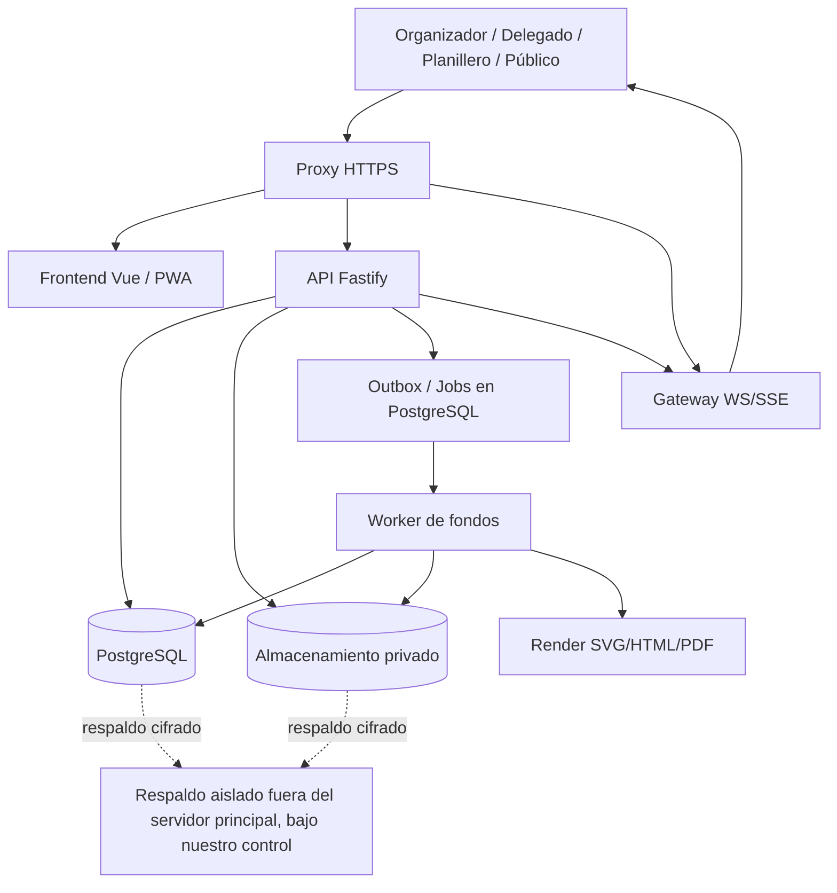
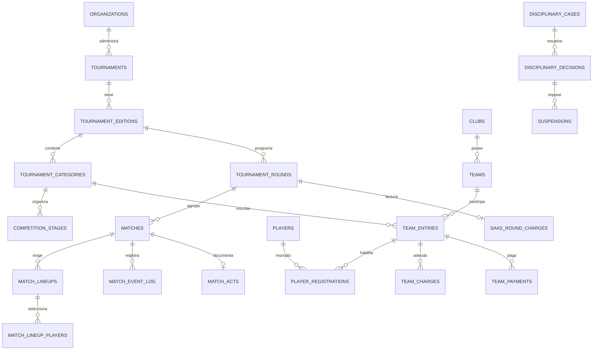

# PROYECTO TORNEOS — ESPECIFICACIÓN MAESTRA PARA CODEX

> **Actualización de alcance — 27/10/2026:** este documento conserva la conversación y el plan originales como antecedente. La decisión posterior del propietario prioriza uso móvil, administración de torneos/equipos, lista de buena fe, fixture, partidos, flyers y portal público. **No planificar cobros, facturación, créditos ni pasarelas.** El superadmin habilita o bloquea manualmente el acceso de administradores de torneos. Para ejecutar el proyecto, prevalecen [decisiones vigentes](docs/01-decisiones.md), [control de acceso](docs/08-activacion-y-control.md) y [tandas actualizadas](docs/tandas/README.md) sobre las secciones comerciales antiguas de este archivo. Todo sigue en fase de planificación, sin implementación.

> **Estado:** documento funcional/técnico de referencia · **Fecha:** 22/10/2026 · **Versión:** 1.1 · **Nombre comercial:** PENDIENTE DE DECIDIR.
>
> **Nombre técnico provisional:** `proyecto-torneos`. No incorporar un nombre comercial definitivo en código, dominio, iconografía, documentación legal ni elementos de identidad. La marca debe poder modificarse mediante configuración.
>
> **Objetivo de este documento:** que Codex y los desarrolladores dispongan de la visión íntegra, las reglas y el plan de implementación; que las entregas incrementales no pierdan funcionalidades ni compromisos del negocio.

## 0. INSTRUCCIONES OPERATIVAS PARA CODEX

1. **No implementar todo en una única tanda.** Usar las tandas numeradas del apartado 19. Antes de cambiar código, inspeccionar el repositorio actual, detectar stack, convenciones, migraciones y trabajo ya existente, y elaborar tareas concretas.
2. **No sustituir requisitos confirmados por suposiciones.** Distinguir entre: `CONFIRMADO` (decisión del propietario), `PROPUESTO` (recomendación de este documento) y `POR VALIDAR` (decisión comercial/reglamentaria pendiente). No bloquear el desarrollo por dudas no críticas: escoger valores configurables con migraciones seguras.
3. **No bautizar el producto aún.** Usar textos neutros, nombre configurable y `Proyecto Torneos` como referencia interna.
4. **Negocio confirmado:** una sola modalidad comercial, **Gs. 20.000 (PYG) por fecha/jornada facturable** de un torneo, **todas las funcionalidades disponibles**, sin planes Básico/Pro/Premium, sin cobro por jugador, equipo, delegado o árbitro. La definición técnica de jornada facturable se explica en §13.
5. **Enfoque confirmado:** plataforma SaaS multiorganizador, web/PWA, destinada a fútbol de campo, fútbol 5, fútbol 7, fútbol 8, futsal y otros formatos personalizados. **No codificar reglas universales basadas solo en el nombre del deporte.**
6. **Independencia total en esta fase (CONFIRMADO):** **NO IA**, **NO OTP de ningún tipo** (SMS, correo, TOTP, aplicaciones autenticadoras), **NO SMS**, **NO servicios externos ni integraciones de terceros** en el MVP, incluso si fueran gratuitos. No conectar pasarelas de pago, proveedores de correo/API, OAuth social, CDN externas, servicios de mapas, analítica SaaS, servicios de mensajería, datos deportivos ni generadores gráficos en la nube. Toda función del producto debe ejecutarse mediante el servidor propio y componentes autohospedados. Se permiten bibliotecas de código abierto instaladas localmente y el DNS/certificado necesarios para operar en Internet; no equivalen a integrar servicios de negocio de terceros. Mantener respaldos cifrados fuera del servidor principal mediante medios bajo nuestro control, sin incorporarlos al flujo funcional ni exigir un proveedor SaaS.
7. **Prioridad absoluta de experiencia:** la pantalla de planilla y partido en vivo debe permitir registrar la mayoría de eventos deportivos rápidamente con pocos toques, funcionar bien desde teléfono y ofrecer correcciones auditables.
8. **Seguridad desde el inicio:** aislamiento entre organizadores; permisos de torneo/equipo/partido; protección de documentos y menores; sin exposición pública de DNI/identidad completa, autorizaciones, deudas personales ni archivos privados.
9. **Integridad de resultados:** los eventos del partido son un registro auditable; los marcadores, goleadores, tablas y sanciones se derivan de eventos/resultados válidos y no se actualizan como fuentes independientes sin sincronización.
10. **Cada tarea debe incluir**: migración, modelo, reglas de negocio, endpoints/servicios, UI responsive, estados de carga/error/vacío, permisos, pruebas unitarias, pruebas de integración y e2e prioritarias, documentación de uso y rollback donde proceda.
11. **No hacer cambios destructivos** de datos, borrado de producción, migraciones incompatibles, cambios de infraestructura o importaciones masivas sin respaldo previo y mecanismo de recuperación.
12. **No generar diseño visual final sin sistema de diseño.** Interfaces rápidas y coherentes en escritorio/tablet/móvil; probar con usuarios que realmente administran planillas en cancha.

---

## 1. VISIÓN, PÚBLICO Y PROPUESTA DE VALOR

**Producto:** una plataforma SaaS, con identidad visual configurable por organizador/campeonato, que digitaliza la creación, operación, control deportivo, disciplina, finanzas y difusión pública de torneos de fútbol y sus variantes. Abarca desde el alta de clubes, jugadores y cuerpo técnico hasta la entrega de premios, historial de temporadas e informes.

**Clientes principales:** organizadores barriales y comunitarios, ligas de fútbol de campo, torneos de fútbol 5/7/8, futsal/fútbol de salón, campeonatos municipales, escolares, universitarios, empresariales, interbarrios y clubes. Inicialmente orientado a Paraguay, preparado para otros países y monedas en el futuro.

**Usuarios beneficiarios:** superadministrador de SaaS; organizador/administrador; personal de organización (deporte, disciplina, finanzas); delegados; planilleros; árbitros; técnicos; espectadores sin cuenta. Jugadores registrados no requieren iniciar sesión en el MVP.

**Promesa central:** una sola aplicación para inscripciones, planillas, habilitaciones, transferencias, préstamos, fixture, partidos en vivo, estadísticas, sanciones, multas, cobros, recibos, PDF, flyers y portal de aficionados. Debe eliminar hojas de cálculo y procesos manuales innecesarios.

**Principios:**
- Configurable por campeonato: modalidad, cantidades de jugadores, suplentes, límites de inscripción, reglamentos, puntuación, sanciones y calendarios.
- Móvil primero en cancha; panel cómodo en escritorio para organización y finanzas.
- Aislamiento entre organizadores; controles por torneo, equipo y partido.
- Transparencia: quién registró o aprobó qué y cuándo.
- Publicación rápida, sin duplicar datos: un acta oficial alimenta los resultados y estadísticas.
- Precio único sencillo, sin planes diferenciados ni funcionalidades artificialmente bloqueadas.
- Escalabilidad razonable y costes predecibles.

### 1.1 Alcance deportivo

Soportar, por configuración y sin crear proyectos distintos:
- Fútbol 11.
- Fútbol 9 / fútbol 8 / fútbol 7 / fútbol 6 / fútbol 5.
- Futsal o fútbol de salón, incluidos formatos con sustituciones ilimitadas.
- Torneos infantiles, juveniles, mayores, senior, masculinos, femeninos, mixtos u otras categorías organizativas.
- Ligas y copas con fases de grupos, todos contra todos, eliminatorias, semifinales, finales, ida/vuelta y combinaciones.
- Campeonatos amistosos con reglas locales específicas, **siempre dejando claro que son ajustes definidos por el organizador, no avales de federaciones**.

### 1.2 Decisiones confirmadas y pendientes

**CONFIRMADO**
- Un producto SaaS multi-tenant.
- Superadmin con visibilidad global; admin organizador con sus torneos; delegado con acceso a su equipo; rol restringido para planillero/árbitro.
- Pantalla en vivo o de completar partido extremadamente rápida.
- Fichas de clubes/equipos, plantilla, cuerpo técnico, transferencias, préstamos, inscripciones, fixture, calendario, clasificación, goleadores, amarillas, rojas, suspensiones, sanciones, multas, pagos, deudas y cobros.
- Generador de flyers usando escudos y campos como fecha, hora, lugar y precio de entrada.
- Precio único inicial: **20.000 guaraníes por fecha**.
- Modalidad deportiva adaptable con cantidades configurables de titulares, banco y plantilla.
- Nombre aún no elegido; se están evaluando **A la Cancha**, **Torneo Kure**, **Rivaldo** y **Partidos**, sin seleccionar ninguno ni usar marcas definitivas en código.
- **Excluido sin excepción en esta fase:** IA, OTP, SMS e integraciones externas/APIs de terceros (incluidos proveedores gratuitos). Autenticación por usuario/contraseña y herramientas autohospedadas.
- **Cobros:** registrar y validar pagos manualmente; no conectar pasarelas ni procesadores externos.

**PROPUESTO**
- Definir 'fecha' como jornada oficial del torneo (no como día natural ni partido), con un identificador único; múltiples encuentros/categorías pueden pertenecer a la misma jornada. Cobrar una sola vez al publicarla por primera vez.
- Cobro inicialmente manual/prepagado con control desde superadmin, sin pasarela obligatoria.
- Vue 3 + TypeScript + PWA, Fastify/Node.js, PostgreSQL y worker autohospedado.
- Evento provisional en vivo y posterior acta oficial; correcciones con trazabilidad.
- Plantillas de reglamentos como punto de partida, siempre editables.

**POR VALIDAR (NO BLOQUEA EL DISEÑO; CONFIGURAR)**
- Cómo se cuenta una jornada en torneos simultáneos con calendarios muy diferentes: por defecto un `tournament_round` oficial a nivel del torneo, compartible entre categorías.
- Excepciones, créditos y devoluciones por fechas canceladas; gestión manual auditada por superadmin.
- Reglas locales sobre transferencias, elegibilidad, documentos, sanciones, aranceles y menores según cada campeonato.
- Identidad de marca, dominio, estética y materiales comerciales finales.

---

## 2. ARQUITECTURA CONCEPTUAL DE NEGOCIO

```text
PLATAFORMA SAAS
  ├── Superadministradores internos
  └── ORGANIZACIONES ORGANIZADORAS (tenants)
       ├── Propietario / administradores / empleados autorizados
       ├── Perfil público y marca del organizador
       ├── TORNEOS (cada uno con temporadas/ediciones)
       │    ├── Categorías/divisiones (p.ej. Libre, Senior, Sub-17)
       │    ├── Reglamento deportivo versionado por división
       │    ├── Fases: liga, grupos, eliminatorias, final
       │    ├── Jornadas/fechas OFICIALES facturables
       │    ├── Partidos, árbitros, actas y eventos
       │    ├── Clasificaciones, estadísticas y sanciones
       │    ├── Finanzas, multas, pagos e informes
       │    ├── Portada, patrocinadores, PDFs y flyers
       │    └── Portal público consultable sin login
       └── CLUBES / EQUIPOS
            ├── Identidad y escudo
            ├── Delegados habilitados
            ├── Plantilla de jugadores, cuerpo técnico
            ├── Inscripciones en divisiones/temporadas
            ├── Transferencias / préstamos / habilitaciones
            └── Planillas de convocados por partido
```

**Definiciones:**
- `Organización`: cliente del SaaS. Posee sus torneos, clubes asociados, usuarios y finanzas internas.
- `Torneo`: campeonato visible al público; puede abarcar divisiones y ediciones.
- `Edición/temporada`: instancia anual o por ciclo. Debe conservar historial al organizar una nueva edición.
- `Categoría/división`: competición dentro de la edición, con reglamento y clasificaciones propios.
- `Jornada/fecha`: bloque oficial de programación y facturación; **no equivale a un día del calendario**.
- `Partido`: encuentro concreto, adscrito a una categoría/fase/jornada.
- `Club`: entidad deportiva que puede tener varios equipos/categorías.
- `Equipo`: participante deportivo dentro de una división y edición; puede tener plantillas históricas.
- `Jugador`: persona registrada dentro de la organización, que puede cambiar de equipo o participar en diversas ediciones según reglas.
- `Inscripción`: permiso deportivo del jugador para un equipo/categoría/periodo.
- `Planilla de partido`: selección de titulares, suplentes, cuerpo técnico y dorsales para un encuentro concreto.
- `Acta`: documento/registros con resultado, incidentes, observaciones y estado oficial.

**Prohibido:** usar el número de dorsal como identidad de jugador, mezclar jugadores de dos organizaciones o reutilizar datos históricos sin versión/snapshot.

---

## 3. MATRIZ DE ROLES, ALCANCES Y PERMISOS

### 3.1 Superadministrador (`platform_superadmin`)
- Panel global de organizaciones, torneos, jornadas, usuarios, cuentas, consumo, ingresos, errores y actividad.
- Alta/baja/bloqueo de organizaciones, acceso a configuraciones, correcciones de cargos, recepción/conciliación de pagos SaaS, precios históricos, soporte y auditoría.
- Ver detalle deportivo cuando resulte necesario y autorizado para soporte; acceso a documentos personales **no abierto por defecto**.
- Toda acción sensible requiere bitácora con actor, motivo y fecha; accesos de soporte temporales y justificados.

### 3.2 Administrador/propietario de organización (`organization_owner`, `organization_admin`)
- Alta y administración de sus torneos, ediciones, categorías, reglas, equipos, jornadas, horarios, sedes y árbitros.
- Admisión/rechazo de inscripciones y transferencias; validación de habilitaciones.
- Designación de delegados, planilleros, árbitros, colaboradores y permisos específicos.
- Aprobación de actas y sanciones, gestión de recursos, cobros y documentos.
- Gestión de escudos, patrocinadores, textos públicos y flyers.
- Solo puede consultar información de su organización, no la de otro cliente.

### 3.3 Personal organizador (permisos granulares)
- `competition_manager`: deporte, fixture, actas, reglamentos y estadísticas.
- `discipline_officer`: sanciones, tarjetas, multas, apelaciones, habilitaciones.
- `finance_manager`: cargos, pagos, recibos, deudas, caja e informes económicos.
- `registrar`: documentos, fichajes y registros, sin modificar finanzas ni actas.
- Un mismo usuario puede combinar permisos, con asignaciones por torneo o categoría.

### 3.4 Delegado (`team_delegate`)
- Gestiona solo clubes/equipos explícitamente asignados.
- Edita datos autorizados de su club, escudo y cuerpo técnico.
- Propone/carga jugadores; solicita inscripción, transferencias o préstamos; adjunta documentos.
- Consulta estados de habilitación y sanciones de su equipo.
- Arma y envía la planilla de cada partido seleccionando titulares, banco y no convocados desde la nómina disponible.
- Consulta cuotas, deudas, multas y pagos; adjunta comprobantes si el organizador permite.
- No puede aprobar su propia transferencia, condonar multas, modificar el fixture ajeno, marcar un acta oficial ni ver documentos privados de otros equipos.

### 3.5 Planillero / árbitro (`match_operator`, `referee`)
- Acceso exclusivo a partidos asignados, horarios y plantillas autorizadas.
- Registro en vivo de goles, tarjetas, cambios, incidencias, tiempos, resultado y observaciones.
- Correcciones antes del cierre con trazabilidad; envío de acta a revisión.
- No puede alterar pagos, jugadores de otros torneos ni resultados oficiales de partidos ajenos.
- Un partido puede tener responsable de captura y revisor diferentes.

### 3.6 Otros roles
- `coach_staff`: aparece en cuerpo técnico y, si se le habilita, consulta planillas propias; sin privilegios administrativos por defecto.
- `public`: público anónimo para fixture, resultado, tabla, goleadores, estadísticas autorizadas, noticias y flyers.
- Futuro `player`: portal individual opcional, **no necesario para el MVP**.

### 3.7 Seguridad de permisos
- RBAC para rol **más** comprobación de pertenencia/alcance: organización, torneo, categoría, equipo y partido.
- Todas las rutas de servidor verifican autorización, nunca confiar en botones ocultos del frontend.
- Un delegado con dos equipos tiene asignaciones separadas; su cambio de contexto es explícito.
- Soporte de revocación inmediata de permisos/sesiones.
- Accesos restringidos a fichas y documentos de menores; exposición pública mínima.

---

## 4. MARCA BLANCA, IDENTIDAD Y EXPERIENCIA

1. Perfil del organizador: nombre, logo, portada, descripción, contacto, localidad, redes sociales.
2. Página de cada torneo/temporada con logo, paleta, patrocinadores, ubicación y resumen.
3. Escudos y colores de equipos con formatos optimizados y versión miniatura.
4. URL pública con slug único configurable; opción futura de dominio propio.
5. PWA responsive instalable; móvil prioritario para delegado y planillero; escritorio para organizador y finanzas.
6. Portal sin login para seguidores; panel administrativo solo con sesión.
7. Navegación: **Organización → Torneo → Categoría → Jornada → Partido**, con selector rápido.
8. Textos configurables, formatos de fecha y hora según zona horaria; PYG como moneda inicial; preparado para i18n.
9. Confirmaciones sensibles, estados vacíos útiles, notificaciones internas y accesibilidad básica.
10. Formularios con autoguardado y validaciones junto al campo, no únicamente al enviar.
11. Portal publicable/ocultable por torneo y por etapa; posibilidad de resultados en vivo preliminares.
12. SEO básico, enlaces compartibles, metadatos sociales y código QR hacia el partido o torneo.

---

## 5. CREACIÓN DE TORNEOS Y REGLAMENTOS CONFIGURABLES

### 5.1 Asistente de creación

- Nombre, edición/temporada, municipio, organizador, descripción, imagen, escudo, patrocinadores.
- Modalidad: F11, F9, F8, F7, F6, F5, FUTSAL, PERSONALIZADO; el nombre selecciona un **preset editable** y no determina permanentemente las reglas.
- Categorías/divisiones (Libre, Primera, Senior, Sub-X, femenino, mixto, etc.); requisitos propios.
- Número de equipos, sistema de competición, fases, grupos, ida/vuelta, rondas, cruces.
- Puntos por victoria/empate/derrota (p. ej. 3/1/0) y orden configurable de desempate.
- Criterios de clasificación, clasificados, playoffs, semifinales, finales, descensos si se usan.
- Jornadas oficiales previstas (normalmente 8 a 15, pero sin imponer límite rígido).
- Sedes/canchas, disponibilidad horaria, duración, intervalos, descanso entre partidos.
- Precios propios del torneo: inscripción, arancel, multas, arbitraje, entrada, otros conceptos.
- Documentos reglamentarios y autorización para publicar inscripciones/datos.
- Vista de resumen antes de publicar con validaciones y advertencias.

### 5.2 MODELO DE REGLAMENTO DEPORTIVO (MUY IMPORTANTE)

Configurable **por categoría/división/edición** y copiable desde una plantilla:

| Campo | Significado | Ejemplo orientativo |
|---|---|---|
| `players_on_field` | Total simultáneo por equipo, **incluido arquero** | 5, 7, 11 |
| `minimum_to_start` | Mínimo requerido para comenzar | Determinado por reglamento |
| `minimum_to_continue` | Mínimo requerido para continuar | Determinado por reglamento |
| `requires_goalkeeper` | Si es obligatorio identificar arquero | Sí |
| `max_registered_players` | Máximo en nómina del equipo para esta edición/división | 25, 30, ilimitado (NULL) |
| `max_match_roster` | Máximo de jugadores en acta/planilla del encuentro | 12, 14, 18, 23 |
| `max_bench_players` | Máximo de suplentes sentados o convocados | 5, 7, 9 |
| `max_bench_staff` | Máximo de miembros de cuerpo técnico en planilla | 3, 5 |
| `substitution_mode` | Limitadas / ilimitadas / volantes | `limited`, `unlimited`, `rolling` |
| `max_substitutions` | Máximo de cambios usados si son limitados | 5 o NULL |
| `max_substitution_windows` | Ventanas de cambios si se usan | 3 o NULL |
| `reentry_allowed` | Si un reemplazado puede volver a entrar | Sí/No |
| `match_periods` | Cantidad de tiempos y duración de cada uno | 2 × 20, 2 × 45 |
| `clock_mode` | Ascendente, regresivo, manual | Según formato |
| `clock_stops` | Si el cronómetro se detiene oficialmente | Configurable |
| `extra_time_policy` | Prórroga y formato | Ninguna, 2 × N |
| `penalty_shootout_policy` | Penales definitorios | Sí/No + reglas |
| `points_win/draw/loss` | Sistema de puntaje | 3/1/0 |
| `tie_breakers` | Orden de desempates | puntos, diferencia, goles, enfrentamiento, fair play, sorteo |
| `yellow_card_policy` | Umbrales y vigencia de amarillas | por fase o torneo |
| `second_yellow_policy` | Consecuencia de dos amarillas en el mismo juego | configurable |
| `red_card_policy` | Mínimos de sanción, revisión y acumulación | configurable |
| `staff_card_policy` | Amonestaciones al cuerpo técnico | sí/no |
| `suspension_service_policy` | Cuándo se cumple una suspensión | partidos oficiales válidos |
| `registration_deadline` | Plazo de habilitación de jugadores | fecha/corte configurable |
| `lineup_deadline` | Hasta cuándo puede presentarse la planilla | configurable |
| `roster_lock_policy` | Momento y actor que bloquea nómina/planilla | al iniciar/por organizador |
| `age_eligibility` | Requisitos de edad por categoría | fecha de corte configurable |
| `foreign_player_limit` | Límite opcional si lo adopta el torneo | configurable |
| `walkover_rules` | Marcador, puntos, sanciones por incomparecencia | configurable |
| `fine_catalog` | Multas definidas por reglamento | importes en PYG |

**Precaución:** presets sugeridos NO equivalen a la normativa federativa vigente; el organizador aprueba y publica su reglamento. Futsal puede usar cambios ilimitados, mientras fútbol de campo puede tener límites y ventanas diferentes. El sistema no debe asumir que dos torneos de «fútbol 7» usan el mismo banco, planilla o sustituciones.

### 5.3 Reglas matemáticas de la planilla

Variables:
- `N` = jugadores en cancha permitidos (`players_on_field`).
- `R` = máximo total en planilla (`max_match_roster`).
- `B` = máximo de suplentes (`max_bench_players`).
- `G` = máximo inscritos de plantilla general (`max_registered_players`, nullable).
- `S` = seleccionados titulares; `U` = seleccionados suplentes; `L` = jugadores inscritos elegibles en el equipo.

Validaciones mínimas:
- `0 <= S <= N`.
- `0 <= U <= B`.
- `S + U <= R`.
- `S + U <= L` y sin duplicar una misma persona.
- `L <= G` si `G` no es NULL.
- Para aprobar un inicio normal, `S >= minimum_to_start`; y `S <= players_on_field`.
- Si el reglamento exige arquero, al menos un titular debe estar marcado como arquero.
- Un futbolista no debe estar a la vez en titulares y suplentes, ni figurar dos veces.
- Las suspensiones, habilitaciones, préstamos vigentes, edad y documentación producen elegibilidad según fecha/instancia **del partido**, no solo según la fecha actual del servidor.
- Si hay excepción autorizada por organizador: se registra **motivo, responsable, fecha y efecto**, nunca un silencioso `force=true` sin bitácora.

**Ejemplo fútbol 7 configurado:** `N=7`, `R=15`, `B=8`, `G=30`: de 30 jugadores inscriptos, el delegado elige como máximo 7 titulares + 8 suplentes; el resto aparece como **no convocado**, no desaparece de su plantilla general.

**Ejemplo futsal:** `N=5`, `R=14`, `B=9`, `G=25`; los cambios pueden ser ilimitados. La elección de 5/9 es un ejemplo de configuración y no se debe imponer como norma universal.

### 5.4 Versionado

- Guardar reglas con `rule_set_id` + `version`; la publicación genera snapshot inmutable.
- Cada partido conserva referencia/instantánea de las reglas bajo las que fue jugado.
- Cambiar reglas después de disputarse encuentros requiere versión nueva y fecha efectiva.
- No recalcular retrospectivamente sanciones o tablas sin una operación explícita de corrección aprobada, con vista previa de efectos.

---

## 6. CLUBES, EQUIPOS, JUGADORES Y CUERPO TÉCNICO

### 6.1 Clubes y equipos
- Crear club con nombre, apodo, sigla, escudo, colores, localidad, barrio, contacto y redes.
- Un club puede participar en muchas categorías y ediciones con diferentes equipos.
- Contactos y delegados asignados; varios delegados por equipo con permisos personalizados.
- Cuerpo técnico: entrenador, ayudante, preparador físico, delegado, encargado médico, utilero y otros roles configurables.
- Dorsales, posiciones, capitán, arquero y fotografías.
- Historial de plantillas, participaciones, resultados y trofeos.
- Documentos obligatorios por torneo, fechas de vencimiento y estado de verificación.
- Importación masiva con CSV/Excel (validación, informe de errores, vista previa antes de aplicar).

### 6.2 Perfil del jugador
- Identificador interno UUID, nombre completo, nombre para mostrar, foto, nacionalidad opcional, fecha de nacimiento cuando proceda, documento personal privado si se necesita, contacto autorizado, observaciones.
- Número de documento único solo dentro del alcance legal y comercial apropiado; no usar DNI como clave primaria ni publicarlo.
- Consentimientos y permisos, en particular menores de edad.
- Historial por temporadas, clubes, equipos, inscripciones, transferencias, préstamos y sanciones.
- Actividad y estadísticas por torneo/categoría/edición.
- Estados de inscripción: borrador, presentado, en revisión, habilitado, rechazado, suspendido, retirado.
- Documentación privada con acceso restringido.

### 6.3 Inscripciones, transferencias y préstamos
- Solicitud de inscripción por delegado, revisión por organizador y resolución motivada.
- Nueva alta, renovación, baja, transferencia definitiva y préstamo temporal.
- Equipo origen/destino, competición, inicio/fin de vigencia, documentos, autorización y estado.
- Estados: borrador → solicitado → pendiente de validaciones → aprobado/rechazado/cancelado.
- Al vencer préstamo, resolver automáticamente **situación administrativa propuesta**; evitar transferencias de habilitación deportiva automáticas no autorizadas.
- Bloqueos contra inscripciones simultáneas incompatibles en una misma categoría/periodo, salvo permiso reglamentario.
- Ventanas de transferencias, cupos y restricciones por torneo.
- Registrar historial y motivos; no borrar una inscripción anterior cuando un jugador cambia de equipo.
- Historial interorganizacional NO se comparte por defecto; solo con consentimiento, integración y mecanismo de identidad específicos futuros.

### 6.4 Flujo del delegado
1. Entra a su organización/torneo/equipo.
2. Consulta nómina y estados de habilitación.
3. Agrega jugador o envía inscripción/transferencia/préstamo.
4. Adjunta documentación requerida.
5. Recibe cambios de estado y observaciones.
6. Antes de un partido, arma planilla desde la lista de habilitados.
7. Consulta deudas, multas, sanciones, fixture y resultado de su club.

---

## 7. PLANILLA DIGITAL POR PARTIDO — MÓDULO PRIORITARIO

### 7.1 Experiencia esperada

**Interfaz móvil:**

```text
Club A vs Club B · Fecha 5 · Categoría Libre
Mi equipo: CLUB A
[ Buscar jugador, dorsal o apellido __________ ]
[ TITULARES 6/7 ]  [ SUPLENTES 7/8 ]  [ NO CONVOCADOS 17 ]

#01  José Gómez    ✓ Habilitado   [Titular] [Suplente] [—]
#09  Diego López   ✓ Habilitado   [Titular] [Suplente] [—]
#05  Pedro Vera    ! Suspendido   [Bloqueado: ver motivo]
...

Arquero: [#01 José Gómez v]     Capitán: [#09 Diego López v]
Cuerpo técnico: [Seleccionar de miembros habilitados]
[Guardar borrador]  [Presentar planilla 13/15]
```

**Funciones:**
1. Lista de jugadores vigentes del equipo con fotos, dorsal, estado y filtros.
2. Selección con un toque entre TITULAR / SUPLENTE / NO CONVOCADO.
3. Contadores visibles en tiempo real `Titulares X/N`, `Banco Y/B`, `Planilla Z/R`.
4. Búsqueda inmediata, orden por dorsal y favoritos/última convocatoria.
5. Copiar convocatoria anterior con validación de vigencia actual.
6. Auto-selección sugerida **sin IA** a partir de última planilla, siempre revisable.
7. Selección de arquero y capitán; miembros del cuerpo técnico autorizados.
8. Indicadores de documentos pendientes, sanciones, transferencias o falta de habilitación.
9. Si se supera límite, bloquear selección adicional mostrando regla exacta y contador.
10. Guardar como borrador; enviar para aprobación/confirmación; sellar fecha/autor.
11. Vista de las planillas de ambos clubes para planillero/árbitro y administrador.
12. PDF de lista de buena fe/planilla inicial con escudos, dorsal, nombres y firmas cuando corresponda.
13. Registro de ausentes, jugadores que llegan tarde y excepciones según reglamento.
14. Bloqueo y congelación de snapshot al iniciar el partido; cambios posteriores solo como eventos autorizados.
15. En pantalla de partido, cargar por defecto los jugadores **convocados**, no toda la plantilla histórica.

### 7.2 Ejemplo de elegibilidad y estados

- Verde: habilitado y disponible.
- Amarillo: documentación pendiente o condición que requiere decisión del organizador.
- Rojo: sancionado, no inscripto, fuera de ventana o no autorizado; no seleccionable hasta corrección administrativa formal.
- Si una suspensión está apelada, mostrar estado procedimental y decisión vigente; no asumir automáticamente que la apelación levanta la sanción.
- Las reglas de elegibilidad deben tener efecto temporal: un préstamo vence, una sanción se cumple, una categoría tiene fecha de corte.

### 7.3 Condiciones de aceptación

- Para F7 con `N=7`, `B=8`, `R=15`, no se pueden seleccionar 8 titulares ni 9 suplentes.
- Si se seleccionaron 7 titulares + 8 suplentes, la siguiente elección queda deshabilitada y explica el límite.
- Ningún jugador puede ocupar dos roles de convocatoria simultáneamente.
- El delegado de Club A no puede convocar jugadores de Club B ni editar sus datos.
- Suspensiones vigentes o transferencias no aprobadas impiden convocatoria, salvo excepción auditada.
- La aprobación produce un snapshot; una baja posterior no borra la planilla histórica.
- En móvil debe poder realizarse selección usando una mano y sin desplazamientos horizontales.

---

## 8. FIXTURE, CALENDARIO Y FASES

### 8.1 Formatos
- Todos contra todos / liga simple; ida y vuelta.
- Fase de grupos con clasificación y cruces.
- Eliminación directa, octavos, cuartos, semifinales, final, tercer puesto.
- Grupos + eliminación; liguillas y playoffs.
- Equipos pares/impares, descansos (`bye`) y fechas libres.
- Partidos de ida y vuelta, marcador global, prórroga y definiciones por penales.
- Partidos programados manualmente y generación automática revisable.
- Torneos con una categoría o múltiples categorías que comparten jornadas.

### 8.2 Generador
- Algoritmo round-robin para fase de liga, opción de ida/vuelta.
- Asignación por fechas/jornadas, canchas, horarios y descanso mínimo.
- Detección de solapamientos: equipo, cancha, árbitro y personas asignadas cuando sea aplicable.
- Ajuste manual drag-and-drop o cambio mediante formulario; guardar historial.
- Partidos pendientes de rival conocido (ganador de llave X), reprogramados, suspendidos y aplazados.
- Reglas de generación configurables: horarios preferidos, localía, evitar choques, días hábiles, feriados.
- Vistas calendario, lista por jornada, tarjetas, impresión y exportación.
- Envío de aviso interno a delegados al publicar/modificar fechas.

### 8.3 Estados
- Jornada: borrador, programada, publicada/facturada, en curso, completada, anulada con crédito autorizado.
- Partido: borrador, programado, pendiente de planilla, listo, en vivo, pausado, finalizado pendiente de acta, oficial, corregido, suspendido, abandonado, anulado, adjudicado (walkover).
- La reprogramación cambia fecha/hora **del partido** y NO crea una nueva jornada facturable.
- Un evento puede ocurrir en día natural diferente al inicio programado y pertenecer a la misma jornada.

---
## 9. PANTALLA DE PARTIDO EN VIVO / COMPLETAR PARTIDO — PRIORIDAD MÁXIMA

### 9.1 Filosofía de interfaz

**Objetivo medible de UX:** con las alineaciones ya aprobadas, registrar un gol o tarjeta ordinaria en aproximadamente **2–3 acciones principales**: elegir tipo de evento, elegir jugador y confirmar, pudiendo configurar confirmación automática para eventos sencillos con deshacer inmediato cuando resulte seguro. Evitar formularios de 10 campos.

Dos modos sobre **el mismo modelo de datos**:
1. **EN VIVO:** el planillero registra eventos conforme ocurren y el público ve datos provisionales permitidos.
2. **COMPLETAR PARTIDO:** se ingresan marcador, goles, tarjetas y acta al finalizar; sin necesidad de haber utilizado reloj en vivo. El sistema puede advertir si el desglose de goles no coincide con marcador e indicar si el registro de goleadores es incompleto.

### 9.2 Boceto de pantalla móvil

```text
[Flecha atrás] Fecha 6 · Primera · Cancha Municipal    [En vivo ●]

  [ESCUDO A]  Club A       2  :  1       Club B  [ESCUDO B]
                    2.º tiempo · 58'
            [▶ Iniciar] [⏸ Pausar] [✎ Minuto]

[ GOL ⚽ ] [ AMARILLA 🟨 ] [ ROJA 🟥 ] [ CAMBIO ⇄ ]
[ Penal ]  [ Falta / timeout ] [ Incidencia ] [ ⋯ Más ]

Seleccionar equipo: [ CLUB A ] [ CLUB B ]
Seleccionar jugador (alineados primero):
[ #9 López ] [ #11 Acosta ] [ #7 Martínez ]  [Buscar...]

Últimos eventos                                      [Deshacer]
58' ⚽ Club A  #9 López
42' 🟨 Club B #5 Pérez
31' ⚽ Club B #10 González

[Ver planilla] [Revisar acta] [Finalizar partido]
```

El boceto ilustra jerarquía funcional, no un diseño visual definitivo. En móvil debe tener botones grandes, textos legibles, contraste y pocos desplazamientos.

### 9.3 Eventos soportados

**Básicos (MVP):**
- Gol normal (equipo y goleador).
- Gol en contra (equipo beneficiado vs. jugador responsable).
- Gol de penal.
- Tarjeta amarilla individual.
- Segunda amarilla + roja derivada, según reglamento.
- Roja directa.
- Cambio: sale un jugador, entra otro; limitaciones de ventanas, reingresos y sustituciones según reglamento.
- Inicio, descanso, segundo tiempo, pausa, reanudación y fin.
- Incidencia arbitral textual.

**Avanzados, habilitables por regla:**
- Asistencia al gol (opcional).
- Penal fallado/atajado; definición por penales **separada** del marcador del partido.
- Lesión, abandono, cambio de arquero, amonestación al cuerpo técnico.
- Tiempo muerto, faltas acumuladas, infracciones de futsal cuando aplique.
- Prórroga, tiempos suplementarios, tanda de penales.
- Suspensión/abandono, protesta, empate por decisión, walkover.
- Gol anulado y corrección posterior.
- Eventos personalizados permitidos por tipo de competición, sin alterar el libro mayor deportivo sin revisión.

### 9.4 Registro rápido

- Equipos siempre visibles y fáciles de cambiar.
- Al abrir un evento, mostrar jugadores **de la planilla de ese partido** ordenados por: en cancha, suplentes, dorsal/apellido.
- Búsqueda por número, nombre o apellido; teclado numérico cuando se escribe dorsal.
- Tiempo predeterminado: minuto de reloj cuando está activo; editable manualmente; permitir minuto desconocido cuando se carga después.
- Gol: elegir equipo → jugador → guardar; marcador se recalcula de manera inmediata.
- Amarilla: elegir equipo → jugador → guardar; si ya tenía una amarilla, mostrar confirmación de segunda amarilla y consecuencia según reglamento.
- Roja: elegir equipo → jugador y motivo/tipo opcional u obligatorio según reglamento.
- Cambio: elegir quien sale y quien entra; mostrar restricciones; en modo de cambios ilimitados optimizar captura. Si el torneo decide no llevar minutos de cambios, permitir modo simplificado manteniendo traza.
- Permitir evento sin jugador identificado solo cuando la regla lo admita, marcándolo **pendiente de completar**; jamás inventar goleador.
- 'Deshacer último evento' visible, limitado por permiso, y siempre auditable.
- Indicador claro de guardado: pendiente local, sincronizando, confirmado por servidor, falló.
- Los datos deportivos nunca dependen exclusivamente del estado del frontend.

### 9.5 Estados y cierre de acta

Flujo ideal:

```text
PROGRAMADO
  -> PLANILLAS_PENDIENTES
  -> LISTO / PLANILLAS_VALIDADAS
  -> EN_VIVO (o MODO_COMPLETAR)
  -> FINALIZADO_PENDIENTE_REVISION
  -> ACTA_APROBADA / OFICIAL
  -> CORREGIDO_OFICIALMENTE (si hay rectificación posterior)
```

1. Planillero finaliza captura y visualiza resumen: resultado, goleadores, tarjetas, cambios, incidentes, fotos/documentos opcionales.
2. Validar que marcador y desglose de goles coinciden **si el torneo exige autores de todos los goles**. Si permite marcador sin autores, informar el porcentaje de desglose incompleto y no inventar estadísticas.
3. Acta pendiente de revisión; árbitro o autoridad autorizada la confirma según reglamento de aprobación.
4. **Solo al hacer oficial** el resultado se incorpora definitivamente a tabla de posiciones, estadísticas oficiales, sanciones propuestas y reportes. Mientras tanto puede haber marcador/progresión provisional identificados claramente.
5. Corregir acta oficial requiere permiso especial, motivo y evento de rectificación. Se reconstruyen proyecciones afectadas y se registran antes/después.
6. Evitar que un usuario finalice un partido dos veces con doble impacto estadístico/financiero.

### 9.6 Registro, orden, sincronización y conflictos

- `match_events` es un log de eventos append-only con `id`, `match_id`, `type`, `team_id`, `actor_id`, `occurred_minute`, `period`, `payload`, `server_created_at`, `client_event_id` único y `sequence_no` por partido.
- Nunca eliminar físicamente un evento deportivo oficial para corregirlo; registrar `EVENT_VOIDED`, `EVENT_REPLACED` o entidad de corrección con referencia a original, actor, motivo y momento.
- `scoreboard`, `player_stats`, `team_stats`, `standings` son **proyecciones derivadas**, regenerables de fuentes oficiales y de reglas versionadas.
- Reglas de idempotencia: cada `client_event_id` una sola vez, aunque el planillero reenvíe por mala señal o repita clic.
- Concurrencia: bloqueo optimista `match_version` o serialización de comandos; resolver cambios simultáneos del árbitro y planillero sin perder un evento.
- WebSocket/SSE para observadores; ante reconexión recuperar desde `sequence_no` en API.
- Registro offline temporal en IndexedDB para **eventos del partido asignado** y envío posterior. Mostrar explícitamente cuándo el público aún no tiene el dato. No garantizar actualización pública en vivo sin internet.
- El cronómetro del navegador no es fuente de tiempo oficial: servidor guarda estado/instante base y permite corrección por árbitro; el planillero puede introducir minutos manuales.
- Cuando alguien está capturando offline y otro captura online, no aplicar ciegamente eventos conflictivos: identificar colisiones, exigir conciliación y preservar evidencia.
- Sincronización con transacciones: evento aceptado + actualización de estado + `outbox` dentro de la misma transacción.

### 9.7 Reglas de puntuación

- Goles en contra suman al equipo beneficiado, pero se atribuyen al autor como autogol; **no** suman a su tabla de goleadores.
- Goles de definición por penales determinan desempate, pero **no** aumentan el marcador ordinario ni el ranking de goleadores.
- Un gol anulado no figura en marcador ni goleadores oficiales.
- Sanción que altera resultado administrativo (walkover) modifica el **resultado oficial adjudicado**, conserva marcador de juego y acta para auditoría; las estadísticas se calculan según reglamento, no por suposición.
- Partidos anulados, abandonados o en disputa tienen reglas explícitas de clasificación y suspensión de publicación.
- Una corrección posterior de un gol debe cambiar marcador y tabla **una sola vez**; todos los cálculos son repetibles/idempotentes.

### 9.8 Vista de completar partido de manera rápida

- Selección jornada → partido.
- Campo marcador local/visitante destacado.
- Opcional 'agregar goleadores' de manera rápida con dorsal.
- Tarjetas por jugador en grilla con botón amarillo/rojo, contador por equipo.
- Registrar incidentes/sanciones, resultado de penales y observaciones.
- Presentar resumen completo antes de enviar acta.
- Posibilidad de guardar parcialmente sin confirmar.
- Si no se conoce autor de todos los goles, guardar marcador correcto y el desglose incompleto claramente identificado cuando esté permitido.

### 9.9 Criterios de aceptación de la pantalla estrella

1. Gol normal visible en marcador tras confirmación y público se actualiza si está conectado.
2. Gol en contra beneficia al contrario, sin sumarlo a goleadores del anotador en propia portería.
3. Segunda amarilla produce consecuencias configuradas y no duplica la misma expulsión.
4. Una sustitución verifica convocados, reingreso y límite por reglamento.
5. Deshacer y corregir no borran la evidencia; son rastreables.
6. No se registran eventos para jugador de equipo ajeno.
7. No se puede cerrar oficialmente partido sin autorización.
8. Dos usuarios o dos envíos offline no duplican goles ni tarjetas.
9. Modo de captura post-partido comparte lógica de resultados con modo en vivo.
10. Historial oficial y gráfico de tabla no se desincronizan tras una rectificación.

---

## 10. TABLAS, ESTADÍSTICAS, HISTORIA Y CLASIFICACIONES

### 10.1 Clasificación
- Posición, partidos jugados/ganados/empatados/perdidos, goles a favor/en contra, diferencia, puntos.
- Puntos descontados/bonificaciones **con decisión administrativa auditada**.
- Aplicar desempates ordenados configurados por fase/división: puntos, diferencia, GF, enfrentamiento directo, disciplina, sorteo manual documentado, etc.
- Mostrar 'tabla en vivo provisional' separada de tabla oficial si habilitada.
- Soporte a grupos y fases sin mezclar clasificaciones no comparables.
- Clasificación previa a playoff y cruces derivados, con revisión administrativa.
- Actualización tras acta oficial y tras rectificación válida.

### 10.2 Jugadores y equipos
- Goleadores, asistencias cuando se registran, penales convertidos, tarjetas amarillas/rojas, expulsiones, partidos disputados, minutos si existen, titularidades, cambios.
- Estadísticas de club/equipo: forma últimos X partidos, mejor ataque/defensa, resultados, rachas, posiciones históricas.
- Registros personales y del cuerpo técnico solo para datos que realmente se cargan; no generar datos ficticios.
- Histórico entre ediciones y temporadas; filtros por fecha, categoría y estado oficial.

### 10.3 Datos de origen y proyecciones
- Fuente deportiva de verdad: **actas oficiales + eventos validados + decisiones disciplinarias**.
- Materializaciones/tablas de lectura opcionales para rendimiento; invalidación/reconstrucción automática y versión de cálculo.
- Tabla de goleadores debe excluir autogoles y definiciones por penales salvo vista separada.
- Ante sanciones que cambien puntos o resultados, guardar decisión, motivos y snapshot y recalcular.
- Publicación de rankings configurada por organizador (datos mínimos para menores).

---

## 11. DISCIPLINA, PROTESTAS, HABILITACIONES Y MULTAS

### 11.1 Acumulación de tarjetas
- Amarillas por jugador y torneo/categoría/fase, con condiciones de reseteo configurables.
- Roja directa vs. expulsión por doble amarilla.
- Sanciones propuestas por regla, con revisión/confirmación de autoridad; **no aplicar decisiones disciplinarias complejas sin control humano**.
- Partidos que cuentan para cumplir una suspensión, fechas efectivas, ejecución, apelaciones y revisiones.
- Alertas de jugador no habilitado al armar planilla y antes de comenzar partido.
- Tarjetas y expulsiones a entrenadores/cuerpo técnico cuando el torneo lo admita.

### 11.2 Sanciones e incidentes
- Catálogo de infracciones reglamentarias, sanciones posibles y sus multas.
- Causa, partido, jugador/equipo/miembro de cuerpo técnico, documentos, evidencias y responsable.
- Estados: `propuesta`, `en_revision`, `resuelta`, `notificada`, `apelada`, `firme`, `revocada`.
- Suspensiones por cantidad de partidos, hasta una fecha, por decisión manual o condición reglamentaria.
- Protestas por resultados, inclusión indebida, errores de planilla y arbitraje; expediente y respuesta.
- Resoluciones sobre incomparecencia, retiro de equipo o partido abandonado.
- Historial de movimientos disciplinarios y efecto en elegibilidad.
- Capacidad de emitir resolución/acta PDF.

### 11.3 Multas
- Multas generadas desde sanción confirmada, importes en guaraníes enteros, posible vencimiento.
- Multas a equipo y, cuando proceda, a personas con manejo de privacidad apropiado.
- Evitar crear dos multas por el mismo expediente/regla/decisión con clave idempotente.
- Descuentos/cancelación/condonación solo por autoridad autorizada y con motivo.
- Estados económicos: pendiente, parcialmente pagada, pagada, anulada.
- Bloqueo deportivo por deuda **solo si lo habilita explícitamente el reglamento**, nunca por defecto.

---

## 12. FINANZAS INTERNAS DEL TORNEO (ORGANIZADOR ↔ CLUBES)

**Esta contabilidad es independiente de los Gs. 20.000 por fecha que el organizador paga a nuestro SaaS.**

### 12.1 Conceptos
- Cuotas de inscripción de clubes/equipos.
- Aranceles por jornada/participación según reglamento.
- Pago de árbitros y planilleros.
- Alquiler de cancha, servicios y gastos operativos.
- Multas, sanciones económicas, protestas y otros cargos.
- Venta de entradas/ingresos generales **como registro manual en MVP**; boletería QR electrónica futura si aporta valor.
- Ingresos de patrocinadores, aportes y premios.

### 12.2 Cuentas y movimientos
- Estado de cuenta por equipo, jornada y campeonato.
- Cargo con concepto, fecha, vencimiento, deudor, importe, moneda, referencia y documento.
- Pago parcial, pago total, anticipo y saldo disponible según políticas.
- Método de pago: efectivo, transferencia, otro; adjuntar comprobante.
- Recibos descargables con identidad del torneo.
- Conciliación manual y registro de usuario que confirmó pago.
- Caja/ingresos/egresos, resumen de deudas y estado general financiero.
- Registros auditables y reversos: **no borrar físicamente pagos confirmados**.
- Exportación CSV/Excel y PDF por equipo, fecha y torneo.

### 12.3 Seguridad financiera
- Solo organizador/finanzas ven balances generales y operaciones privadas.
- Delegado ve únicamente cargos/pagos de sus equipos.
- Los espectadores no acceden a deudas privadas ni documentos de pago.
- Aprobación y justificativo para anulaciones, devoluciones o ajustes.
- Importes en **enteros PYG**, jamás en coma flotante para cálculos monetarios.

---

## 13. FACTURACIÓN DEL SAAS — ÚNICO PRECIO POR FECHA

### 13.1 Política comercial

- **Único precio vigente inicial:** Gs. **20.000 por fecha/jornada oficial publicada del torneo**.
- Sin planes de niveles, sin funciones premium bloqueadas, sin coste extra por club/jugador/categoría/árbitro/partido en la definición inicial.
- Sin cuota mensual obligatoria por el mero paso del tiempo.
- Ejemplos: 8 fechas = Gs. 160.000; 10 = Gs. 200.000; 12 = Gs. 240.000; 15 = Gs. 300.000.
- Si se cambia el precio comercial en el futuro, conservarlo por **versión** y no modificar cargos emitidos.
- El precio se comunica al usuario antes de la publicación de una fecha y en vista previa del torneo.

### 13.2 Definición operativa para evitar confusiones

- `Jornada/fecha facturable` = entidad `tournament_rounds` perteneciente a una edición de torneo, con número/nombre único dentro de esa edición.
- Una jornada puede tener **varios partidos, categorías, canchas, horarios e incluso días naturales distintos**.
- **El hecho facturable sucede una sola vez:** al publicar por primera vez oficialmente esa jornada (o al consumir el crédito de publicación si se usa modalidad prepagada).
- Mover un partido de sábado a domingo, corregir hora, agregar un encuentro pendiente o volver a publicar la misma jornada NO genera segundo cobro.
- Crear borradores, cargar clubes/jugadores o simular fixtures no factura por sí mismo.
- Jornada `anulada` luego de publicar requiere política administrativa explícita de crédito/devolución; historial intacto.
- Cada partido oficial debe estar asociado a una jornada oficial publicada antes de declararse oficial. Evitar partidas 'sin fecha' fuera del control de cobro.
- En múltiples divisiones del **mismo torneo**, una única `round_id` puede agrupar los partidos de todas ellas. No facturar otra vez simplemente por otra categoría.
- Torneos **distintos** del mismo organizador sí tienen sus propias fechas facturables. Esto debe mostrarse claramente.
- **POR VALIDAR COMERCIALMENTE:** reglas razonables para campeonatos excepcionalmente grandes; no crear cargos ocultos ni topes de equipos sin autorización expresa del dueño del producto.

### 13.3 Modelo de cobro simple

**MVP sugerido:**
1. Organizador crea campeonato y todas las jornadas en borrador.
2. Panel muestra jornadas publicables, usadas y saldo/cargo previsto.
3. Organizador solicita activación, o recibe crédito de jornadas habilitadas manualmente por superadmin.
4. Al publicar una jornada, operación transaccional e idempotente crea **un** `saas_round_charge` de 20.000 y marca la fecha como publicada.
5. Superadmin ve cuentas por cobrar/pagos confirmados y emite recibos.
6. Si hay saldo de créditos prepagados, se consume uno por fecha; no consumir dos por doble clic.
7. Suspensión por impago sólo mediante política transparente, conservando acceso a exportar su información y con gracia adecuada.

**No construir pasarela de pago en fase inicial.** Dejar interfaz/servicio de adaptadores para incorporar una en el futuro solo si se decide.

### 13.4 Tablas de monetización
- `saas_price_versions` (`currency=PYG`, `unit=round`, `unit_amount=20000`, vigencia).
- `saas_accounts` (cuenta de la organización, estado).
- `saas_round_charges` (`organization_id`, `tournament_id`, `round_id`, `price_version_id`, `amount`, `status`, `created_at`, UNIQUE de fecha/torneo).
- `saas_credit_ledger` (créditos prepagados de fechas, consumo, devolución, ajuste con justificación).
- `saas_invoices` y `saas_invoice_lines` (resúmenes y comprobantes; distinción de documentos fiscales si aplica).
- `saas_payments` (cobros manuales, conciliación y comprobantes).
- `audit_logs` (quién creó, anuló o corrigió cada movimiento).

### 13.5 Pruebas obligatorias de facturación
- Publicar Fecha 1 de Torneo A crea exactamente **1 cargo de Gs. 20.000**.
- Publicarla de nuevo no crea cargos.
- Mover un partido a otro día no crea cargo.
- Una fecha con partidos de tres categorías sigue representando un único cargo.
- Publicar Fecha 1 de Torneo B genera cargo distinto si es otro torneo.
- Dos solicitudes concurrentes de publicación crean solo un cargo.
- No alterar precio ya facturado al actualizar `saas_price_versions`.
- Crédito/devolución/anulación preservan rastro, actor y motivo.

---

## 14. FLYERS, PANFLETOS, PDF Y PROMOCIÓN — SIN IA

### 14.1 Tipos de plantillas
- Presentación de torneo.
- Fecha/jornada completa (partidos de una jornada).
- Previa de encuentro `Equipo A VS Equipo B`.
- Partido EN VIVO con marcador.
- Resultado FINAL, anotadores y mejores incidencias.
- Tabla de posiciones y clasificación.
- Goleadores, estadísticas y resumen de fecha.
- Fases eliminatorias y llaves.
- Semifinales, final, campeón, subcampeón, entrega de premios.
- Anuncio de inscripciones, comunicado, suspensión/reprogramación, sanciones públicas autorizadas.

### 14.2 Personalización
- Escudos de ambos equipos / múltiples escudos.
- Nombre del torneo, categoría y número de fecha.
- Fecha, día, hora, sede, cancha y localidad.
- Precio de entrada/guaraníes, texto extra, organizador y contactos.
- Colores, imágenes, fondos, patrones, degradados, tipografías empaquetadas con licencias adecuadas.
- Patrocinadores con ubicaciones reservadas.
- Fotografías autorizadas de equipos o jugadores; control de uso de imágenes de menores.
- Tamaños: publicación cuadrada 1080×1080, vertical 1080×1350, historias 1080×1920 y formatos de impresión.
- Campos enlazados a DB + campos libres editables antes de generar.
- Plantilla guardada por organizador/torneo, versión y vista previa.

### 14.3 Motor propio
- Plantillas declarativas SVG/HTML/CSS; representación a PNG/JPG/PDF desde worker propio con herramienta sin servicio externo de pago.
- Los flyers se pueden generar con un clic desde partido, jornada, tabla, goleadores y ganador.
- Generación de miniatura y archivo descargable; compartir enlace o usar opción nativa `share` del navegador cuando exista.
- Filtrado/escape de textos para evitar inyección HTML/SVG, validación de imágenes y límites de tamaño.
- Fuente de verdad: estado deportivo publicado; un flyer ya generado es snapshot, **no se altera silenciosamente** si cambia un partido. Ofrecer 'regenerar' y marcar versión anterior.
- Cuidar tipografía legible, marcas y espacios seguros para Instagram/WhatsApp.
- Posibilidad de plantillas profesionales precargadas, sin editor de diseño libre complejo en el MVP.

### 14.4 PDFs importantes
- Listado de equipos y participantes.
- Lista de buena fe general y planilla específica por partido.
- Fixture por categoría y fechas.
- Acta arbitral / informe del encuentro con firmas si se requieren.
- Tabla de posiciones, goleadores, disciplina.
- Resoluciones/suspensiones/multas, recursos.
- Estado de cuenta del equipo, recibo de cobro y balance de torneo.
- Informes de cierre, campeón y estadísticas finales.

### 14.5 Aceptación
- Flyer toma escudos del equipo correcto, fecha/hora correcta y precio de entrada configurado.
- El usuario puede modificar el texto opcional sin editar imágenes en programas externos.
- Puede generar publicación cuadrada y vertical con la misma fuente de datos.
- Si un encuentro se reprograma, puede regenerar el flyer; se conserva versión anterior para auditoría.
- PDFs y archivos privados tienen URL temporal o verificación de permisos; material público puede compartirse libremente.

---

## 15. PORTAL PÚBLICO Y PARTICIPACIÓN DE AFICIONADOS

**Sin registro y sin contraseña para espectadores.**

1. Índice público de torneos de la organización y enlaces directos a cada campeonato.
2. Portada del campeonato: imagen, reglas públicas, escudos, patrocinadores, edición, categorías y noticias.
3. Calendario, fixtures por jornada/categoría/equipo, sedes y horarios.
4. Partidos próximos, en vivo y finalizados, resultado y detalle de eventos publicables.
5. Tabla oficial por grupo/división, estado de clasificación y posiciones.
6. Goleadores, tarjetas y estadísticas públicas autorizadas.
7. Perfil de club/equipo con escudo, calendario, plantilla que el organizador decida publicar, cuerpo técnico básico y resultados.
8. Ficha de jugador limitada a nombre deportivo, dorsal, club y estadísticas públicas si existe autorización adecuada.
9. Resumen de acta e incidencias no sensibles; detalles disciplinarios solo si el organizador determina que son públicos.
10. Noticias, comunicados, galerías, fotografías y flyers.
11. URLs compartibles y QR por partido, torneo y equipo.
12. Resultados en tiempo real con etiqueta de 'provisional'; oficiales una vez aprobados.
13. Responsive y SEO: metadatos OG para compartir el enlace de una previa o resultado.
14. Sin publicidad invasiva obligatoria; espacios de patrocinio propios del organizador si se habilitan.
15. Evitar exponer documentos, identificaciones, datos de contacto privados, deudas y domicilios individuales.

---
## 16. INFRAESTRUCTURA Y ARQUITECTURA TÉCNICA

### 16.1 Stack sugerido (no reescribir stack ya existente sin necesidad)

| Capa | Opción recomendada | Justificación |
|---|---|---|
| App web | Vue 3 + TypeScript + Vite | Componentes reutilizables, gestión ágil de vistas |
| Estado | Pinia + cliente de consultas/cache | Estado UI y sincronización controlada |
| PWA | Service worker, IndexedDB | Instalación móvil, lectura/captura offline restringida |
| API | Node.js + TypeScript + Fastify | Monolito modular, API versionada y ligera |
| Esquema/migraciones | PostgreSQL + Prisma o SQL versionado | Relaciones, restricciones e integridad histórica |
| Tiempo real | WebSocket o SSE autohospedado | Difusión de partido en vivo y avisos |
| Trabajos | Worker propio sobre PostgreSQL (pg-boss u otro) | PDF, flyers, notificaciones internas, tareas e informes |
| Media | Disco/volumen privado y posibilidad de MinIO | Escudos, fotos, documentos, assets |
| Imágenes/PDF | SVG/HTML + renderizador local (Chromium/Playwright según necesidad) | Plantillas sin APIs externas |
| Autenticación | Sesión segura, Argon2id para contraseñas | Sin OTP en ninguna variante; cuentas gestionadas internamente |
| Despliegue | Docker Compose + proxy inverso + HTTPS | Económico y replicable |
| Monitorización | Logs estructurados, métricas y alertas autohospedadas | Diagnóstico y capacidad |

**Monolito modular inicial**, no microservicios: módulos de autenticación, organizaciones, torneos, reglas, clubes, jugadores, inscripciones, fixture, encuentros, estadísticas, disciplina, finanzas, SaaS, media, publicación y soporte. Worker separado para tareas pesadas pero compartiendo contratos y modelos.

### 16.2 Diagrama de despliegue



### 16.3 Dependencias económicas y límites

- **No IA ni OTP bajo ninguna modalidad** (tampoco TOTP o códigos enviados por correo), **no SMS, no correo transaccional externo, no OAuth social, no pasarelas de pago, no webhooks/integraciones con terceros, no APIs de terceros**, sean gratuitas o pagas, hasta autorización expresa del propietario.
- **Cuentas en MVP:** crear usuarios internamente; el organizador o superadmin genera una invitación de un solo uso con expiración y la entrega por el medio que prefiera fuera de la plataforma. El invitado establece contraseña. La recuperación se realiza por procedimiento asistido y verificado internamente, con revocación de sesiones previas y enlace temporal entregado por la administración; no enviar credenciales ni depender de email/SMS. Preparar mecanismos antiabuso y auditoría.
- **Notificaciones:** bandeja dentro de la app y actualizaciones por WebSocket/SSE propio. Notificación push de navegador solo si no requiere proveedor de negocio ni integración externa; no asumir entrega garantizada.
- **Pagos:** efectivo/transferencia con confirmación manual, sin conexión bancaria ni pasarelas. **Flyers, PDF y medios:** renderizado local, sin API de diseño.
- **Bibliotecas de código abierto instaladas localmente sí están permitidas**: FFmpeg, renderizadores, DB, dependencias npm, etc. Prohibición aplica a servicios e integraciones externas del producto.
- HTTPS con certificados gratuitos; DNS y dominio siguen siendo costes operativos habituales.
- Si hay vídeos de momentos deportivos, limitar tamaño y reproducción; no convertir la app en una plataforma de streaming por defecto.
- Copia de seguridad cifrada **fuera del VPS principal**, preferentemente en equipo/almacenamiento administrado por nosotros o medio desconectado; no confundir redundancia local con respaldo. Evitar depender de integraciones de terceros para el funcionamiento del producto.
- Medir CPU, RAM, E/S de disco, conexiones DB y ancho de banda antes de decidir separar servicios.
- Almacenamiento privado; no guardar multimedia base64 en columnas de PostgreSQL.
- Todas las imágenes públicas se sirven optimizadas y con caché; privadas mediante autorización.

### 16.4 Disponibilidad y rendimiento

- Desktop para creación masiva y móvil para operación de cancha.
- Interacciones optimistas solo cuando se pueda reconciliar el resultado de servidor; mostrar fallo de forma inequívoca.
- Índices por `organization_id`, `tournament_id`, `edition_id`, `match_id`, `round_id`, fechas, estado.
- Paginación e índices de búsqueda en jugadores/equipos/partidos.
- Evitar recalcular todas las temporadas ante cada gol: actualizar proyecciones afectadas, y disponer de reconstrucción integral verificable.
- El público ve un dato actualizado en segundos cuando existe internet y el servidor está operativo; documentar degradación en caso de reconexión.
- PWA offline limitada a borradores, convocatorias consultadas bajo permiso y eventos capturados del partido asignado. Prohibido cachear masivamente documentos de identidad sensibles en dispositivos compartidos.
- Ensayar reconexiones inestables y cortes durante captura; no perder datos aceptados ni duplicar eventos.

### 16.5 Backups, auditoría y seguridad

- Backups automáticos de PostgreSQL y multimedia, cifrados y **probados mediante restauraciones periódicas**.
- Migraciones en staging, backups antes de cambios destructivos.
- Argon2id, protección contra fuerza bruta, rotación/revocación de sesiones, cookies `HttpOnly`/`Secure`/`SameSite` si aplica.
- Sesiones de operador/árbitro con alcance y expiración; control de dispositivos compartidos.
- CSP, validación de carga de archivos, protección CSRF donde corresponda, sanitización de documentos/HTML/SVG.
- Validación de autorización en backend y, para datos con `organization_id`, evaluar RLS de PostgreSQL con roles restringidos; ni superadmin ni workers deben saltarse controles de forma implícita.
- Datos personales de jugadores, especialmente menores, con minimización, permisos y retención. Consentimientos de tutores cuando corresponda y controles de fotografía pública.
- `audit_logs`: antes/después de correcciones críticas con actor, entidad, instante y motivo; no guardar contraseñas/tokens en logs.

---

## 17. MODELO DE DATOS POSTGRESQL PROPUESTO

> **Importante:** el siguiente es el catálogo maestro inicial. No es una migración final lista para ejecutar: Codex deberá diseñar versiones SQL/Prisma reales por tanda, con índices, `CHECK`, claves foráneas compuestas, transacciones, RLS si se adopta y pruebas. **Mantener las relaciones y reglas, aunque varíen los nombres de tablas.**

### 17.1 Convenciones de diseño

- IDs UUID en entidades; `created_at`, `updated_at`, `created_by` si aplica.
- Todas las tablas de negocio privadas incluyen `organization_id` para scoping; asociaciones compuestas verifican que el recurso relacionado pertenezca a la misma organización.
- `tournament_id` referencia a su edición cuando corresponde; distinguir plantilla de edición vigente.
- Moneda PYG como entero `BIGINT`; preparar moneda ISO 4217 en tablas para futura internacionalización.
- Tiempos UTC (`timestamptz`) más zona horaria IANA configurada por torneo para entrada/presentación.
- Soft delete solo donde es admisible; nunca para borrar resultados oficiales, pagos, sanciones o actos sin rastro.
- `status` como enum controlado o texto con CHECK y eventos de transición autorizados.
- `version` en agregados susceptibles a edición concurrente (partido, acta, reglamento, planilla).
- `external_public_id` / slugs no deben reemplazar IDs internos de relaciones.
- Tablas de snapshots y proyecciones son derivables desde datos de verdad; reconstructor idempotente.

### 17.2 Identidad y multi-organizador

| Tabla | Campos críticos / propósito |
|---|---|
| `users` | id, email opcional, login, password_hash, status, locale |
| `user_sessions` | user_id, session_hash, expires_at, revoked_at, device_meta |
| `organizations` | id, owner_user_id, name, status, slug, timezone |
| `organization_branding` | organization_id, logo_media_id, palette, cover_media_id, public_url |
| `organization_memberships` | organization_id, user_id, role, status |
| `resource_access_grants` | user_id, organization_id, resource_type, resource_id, permission, expires_at |
| `invitations` | token_hash, organization_id, target_role, target_resource_id, expires_at, redeemed_at |
| `audit_logs` | actor_id, organization_id, action, entity_ref, reason, before/after redacted |
| `outbox_events` | id, organization_id, type, aggregate_id, payload, status, retry_count |
| `notifications` | recipient_id, organization_id, type, related_resource, read_at |

### 17.3 Torneos, categorías y reglas

| Tabla | Campos críticos / propósito |
|---|---|
| `tournaments` | organization_id, title, slug, public_status, owner, branding |
| `tournament_editions` | tournament_id, label/year, starts_at, ends_at, status |
| `tournament_categories` | edition_id, name, gender/age metadata, status |
| `sport_presets` | global editable template, sport_label, suggested_rule_config |
| `rule_sets` | edition_id/category_id, version, all field/bench/roster/sub/card/score rules, approved_by, effective_at |
| `competition_stages` | category_id, name, type (league/group/knockout/etc.), sequence, status |
| `stage_groups` | stage_id, name, position |
| `stage_group_teams` | group_id, team_entry_id |
| `tournament_rounds` | edition_id, number, label, status, first_published_at, version |
| `category_rounds` | round_id, category_id, stage_id, label/ordinal |
| `venues` | organization_id, name, address, geo optional, surfaces/capacity |
| `venue_availability` | venue_id, date/time, blocked/reserved, reason |
| `sponsors` | organization_id, name, logo_media_id, website/contact public allowed |
| `tournament_sponsors` | edition_id, sponsor_id, placement, period |

### 17.4 Clubes, equipos, jugadores y registros

| Tabla | Campos críticos / propósito |
|---|---|
| `clubs` | organization_id, name, nickname, crest_media_id, locale, colors |
| `teams` | club_id, organization_id, name, short_name, status |
| `team_entries` | team_id, category_id, edition_id, status, joined_at |
| `team_delegates` | team_id, user_id, edition_id, status, permissions |
| `players` | organization_id, display/full name, private birthdate/ID, photo_media_id, status |
| `player_documents` | player_id, media_id, doc_type, expiry, reviewed_by/status, private |
| `player_team_memberships` | player_id, team_id, from/to, active, reason |
| `player_registrations` | player_id, team_entry_id, category_id, approved_at, effective_from/to, status |
| `registration_requests` | player_id, requested_team_entry_id, request_type, docs/status/reason |
| `transfer_requests` | player_id, from/to_team_entry, submitted_by, effective_from, status, approved_by |
| `loan_agreements` | player_id, from/to_team, date_start/end, scope, documents, approved_by |
| `player_eligibility_exceptions` | player_id, category_id, from/to, reason, approving_official, decision_ref |
| `staff_people` | organization_id, name, role_label, private_contact, photo |
| `team_staff_memberships` | staff_id, team_entry_id, role, from/to, status |

**Regla importante:** `players` es identidad dentro de la organización. Los cambios de equipo/torneo se registran mediante inscripciones y pertenencias con fecha efectiva; nunca sobrescribir el equipo histórico del jugador en una sola columna.

### 17.5 Partidos y planillas

| Tabla | Campos críticos / propósito |
|---|---|
| `matches` | organization_id, edition/category/stage/round, home_entry_id, away_entry_id, venue, kickoff, status, version |
| `match_assignments` | match_id, user_id, role (operator/referee/reviewer), status |
| `match_lineups` | match_id, team_entry_id, status, submitted_at, approved_at, frozen_at, version |
| `match_lineup_players` | lineup_id, player_registration_id, role (starter/bench), dorsal snapshot, captain/keeper flags, snapshot_name |
| `match_lineup_staff` | lineup_id, staff_membership_id, function, snapshot_name |
| `match_event_log` | match_id, client_event_id, sequence_no, type, subject/team, period, minute, payload, actor, created_at |
| `match_event_corrections` | match_id, original_event_id, replacement_event_id/null, reason, actor_id, created_at |
| `match_clock_states` | match_id, period, mode, server_anchor, elapsed, is_running, version |
| `match_acts` | match_id, status, score summary, incidents, submitted_by/at, version |
| `match_act_signoffs` | match_act_id, role/actor, decision, reason, decided_at |
| `match_official_results` | match_id, regulation_score, overtime_score, shootout_score, awarded_score, decision_ref, approved_at |
| `match_status_history` | match_id, from/to, actor, reason, timestamp |
| `match_penalty_shootouts` | match_id, phase, rules_version, winner, status |
| `match_penalty_kicks` | shootout_id, team_id, player_id, sequence, outcome |

**Reglas de integridad:**
- `match_lineups`: máximo uno por `match_id + team_entry_id` y debe corresponder a un contendiente del partido.
- `match_lineup_players`: único `lineup_id + player_id`, salvo si se modela por registro con restricción equivalente.
- `match_event_log`: `UNIQUE(match_id, client_event_id)` y `UNIQUE(match_id, sequence_no)`; `sequence_no` asignado por servidor.
- Un partido referencia exactamente dos equipos diferentes, inscriptos en categoría apropiada.
- La modificación de resultado oficial crea nuevo evento/decisión de rectificación con rastro.

### 17.6 Estadísticas, disciplina y finanzas

| Tabla | Campos críticos / propósito |
|---|---|
| `standings_adjustments` | category/stage/team_entry, points_delta, reason/decision, approved_by |
| `standings_projections` | stage/group/team_entry, played/win/draw/loss/gf/ga/points, calculated_version |
| `player_stats_projections` | category/edition/player, goals/cards/appearances, calculated_version |
| `disciplinary_cases` | player/team/staff, source_match, offense, evidence, status, reviewers |
| `disciplinary_decisions` | case_id, decision/version, sanctions, effective_at, resolved_by |
| `suspensions` | decision_id, subject, number_of_matches/dates, served, state |
| `appeals` | case_id, submitted_by, documents, outcome, effective_date |
| `fine_catalog` | category/rule_set, code, description, amount_pyg, status |
| `fines` | case_id, decision_id, debtor_ref, amount_pyg, charge_id, status |
| `team_charges` | team_entry_id, concept, amount_pyg, due_date, related_entity, status |
| `team_payments` | organization_id, team_entry_id, method, amount_pyg, proof_media_id, confirmed_by |
| `payment_allocations` | payment_id, charge_id, amount_pyg |
| `finance_adjustments` | charge/payment ref, signed_amount, reason, approved_by |
| `finance_expenses` | edition_id, concept, amount_pyg, date, receipt_media_id |

**Dinero:** cargos y pagos separados; asignaciones permiten pago parcial de varias deudas. Reversos/ajustes auditados. Nunca inferir que un comprobante adjunto equivale a pago confirmado.

### 17.7 SaaS, documentos, promoción y operación

| Tabla | Campos críticos / propósito |
|---|---|
| `saas_price_versions` | currency, amount_pyg, per_unit='round', valid_from/to |
| `saas_accounts` | organization_id, billing_status, credits_balance_projection |
| `saas_round_charges` | edition_id, round_id, amount_pyg, price_version_id, status; UNIQUE(round_id) |
| `saas_credit_ledger` | organization_id, credit_delta, reason/ref, actor, at |
| `saas_invoices` | organization_id, period, amount, currency, status |
| `saas_invoice_lines` | invoice_id, round_charge_id or adjustment_ref, amount |
| `saas_payments` | organization_id, invoice_id, amount, proof, confirmed_by |
| `media_assets` | owner org, storage_key, mime, bytes, public/private, checksum, processing_state |
| `generated_documents` | owner org, resource_ref, template_version, media_id, created_by |
| `flyer_templates` | owner/global, type, schema_json, version, preview_media_id |
| `generated_flyers` | tournament/match/round, template_version, input_snapshot_json, media_id, created_by |
| `news_posts` | edition/category, author, title, content, publish_status |
| `job_runs` | job_type, payload_ref, status, attempts, started/finished, error_category |

### 17.8 Ejemplo de restricciones SQL (orientativo)

```sql
-- Ilustración parcial: adaptar nombres y claves al esquema definitivo.
CREATE TABLE tournament_rounds (
  id uuid PRIMARY KEY,
  organization_id uuid NOT NULL REFERENCES organizations(id),
  edition_id uuid NOT NULL REFERENCES tournament_editions(id),
  round_number integer NOT NULL CHECK (round_number > 0),
  label text NOT NULL,
  status text NOT NULL DEFAULT 'draft',
  published_at timestamptz,
  version integer NOT NULL DEFAULT 1,
  UNIQUE (edition_id, round_number),
  UNIQUE (organization_id, id)
);

CREATE TABLE saas_round_charges (
  id uuid PRIMARY KEY,
  organization_id uuid NOT NULL,
  round_id uuid NOT NULL UNIQUE,
  price_version_id uuid NOT NULL REFERENCES saas_price_versions(id),
  amount_pyg bigint NOT NULL CHECK (amount_pyg >= 0),
  status text NOT NULL,
  created_at timestamptz NOT NULL DEFAULT now(),
  FOREIGN KEY (organization_id, round_id)
    REFERENCES tournament_rounds (organization_id, id)
);

-- La operación publicarJornada debe:
-- 1) bloquear/proteger la jornada,
-- 2) comprobar permiso, estado y pago/crédito según política,
-- 3) marcar publicada,
-- 4) insertar cargo único si todavía no existe,
-- 5) consumir crédito si corresponde,
-- 6) emitir evento outbox,
-- TODO DENTRO DE UNA TRANSACCIÓN.
```

**Nota:** el esquema SQL ilustrativo requiere también validación de pertenencia de `edition_id` a la organización, tabla de versiones y relaciones completas. No interpretar el ejemplo como seguridad lista para producción.

### 17.9 Relaciones ER resumidas



### 17.10 Índices, consistencia y aislamiento

- Índices compuestos `(organization_id, status)`, `(edition_id, round_number)`, `(category_id, stage_id)`, `(match_id, sequence_no)`.
- Índices de `player_registrations(team_entry_id, status, effective_from, effective_to)` y búsqueda de apellido/dorsal con estrategia adecuada.
- Claves foráneas compuestas para que `match.team_entry` y `player_registration.team_entry` no crucen organizaciones.
- Cálculos de clasificación mediante consultas/proyecciones con control de versión; testear resultado de reinicio/reconstrucción.
- `unique` de cargo por jornada y transacción frente a publicaciones concurrentes.
- Separar usuarios globales de identidades deportivas por organización.
- Pruebas negativas de acceso cruzado en todos los endpoints de lectura y escritura.
- Preparar eventual particionado de `match_event_log` si el volumen lo exige, pero no introducirlo prematuramente.

---

## 18. API PRINCIPAL Y CONTRATOS DE DOMINIO

### 18.1 Endpoints orientativos

```text
/api/v1/auth/*
/api/v1/me, /api/v1/organizations, /api/v1/organizations/:id/members
/api/v1/tournaments, /api/v1/tournaments/:id/editions
/api/v1/editions/:id/categories, /api/v1/categories/:id/rules
/api/v1/editions/:id/rounds, /api/v1/rounds/:id/publish
/api/v1/clubs, /api/v1/teams, /api/v1/team-entries
/api/v1/players, /api/v1/registration-requests
/api/v1/transfers, /api/v1/loans, /api/v1/eligibility/check
/api/v1/matches, /api/v1/matches/:id/lineups
/api/v1/matches/:id/assignments, /api/v1/matches/:id/events
/api/v1/matches/:id/clock, /api/v1/matches/:id/act
/api/v1/matches/:id/act/submit, /api/v1/matches/:id/act/approve
/api/v1/standings, /api/v1/stats/goals, /api/v1/stats/cards
/api/v1/disciplinary-cases, /api/v1/suspensions, /api/v1/appeals
/api/v1/team-charges, /api/v1/team-payments, /api/v1/reports
/api/v1/flyer-templates, /api/v1/generated-flyers
/api/v1/media, /api/v1/notifications
/api/v1/admin/organizations, /api/v1/admin/saas-round-charges
/api/v1/admin/saas-invoices, /api/v1/admin/saas-payments
/public/v1/tournaments/:slug, /public/v1/matches/:id
/public/v1/standings, /public/v1/top-scorers
```

No crear endpoints de administración accesibles sin permiso. `organization_id` activo se obtiene/verifica desde la identidad autorizada, no se confía en el enviado por el cliente.

### 18.2 Comandos de negocio explícitos

Evitar CRUD genérico para transiciones complejas. Servicios/comandos:
- `CreateTournamentEdition`, `PublishTournamentRound`.
- `InviteDelegate`, `AssignMatchOperator`.
- `SubmitRegistration`, `ApproveRegistration`, `RequestTransfer`, `ApproveTransfer`, `CreateLoan`.
- `BuildMatchLineup`, `SubmitMatchLineup`, `ApproveMatchLineup`, `FreezeMatchLineup`.
- `StartMatch`, `RecordMatchEvent`, `CorrectMatchEvent`, `PauseMatch`, `FinishMatch`, `SubmitMatchAct`, `ApproveMatchAct`, `CorrectOfficialAct`.
- `ProposeDisciplinaryCase`, `DecideDisciplinaryCase`, `AppealDisciplinaryDecision`.
- `RecordTeamCharge`, `ConfirmTeamPayment`, `ReversePayment`.
- `RenderFlyer`, `GenerateOfficialPDF`.

### 18.3 Idempotencia, versiones y respuestas

- Exigir `Idempotency-Key` en operaciones de publicar jornada, aprobar acta, confirmar cobro y registrar eventos críticos; claves por actor/organización y alcance.
- Respuestas de conflicto `409` con estado vigente y versión, para que interfaz pueda conciliar.
- Errores de regla claros: `PLAYER_SUSPENDED`, `MAX_BENCH_EXCEEDED`, `ROUND_ALREADY_BILLED`, `MATCH_ACT_LOCKED`, etc.
- Validación del servidor como fuente de verdad; mensajes legibles al usuario.
- Publicar documentación OpenAPI y tipos generados para frontend cuando corresponda.

---
## 19. PLAN DE DESARROLLO EN 9 TANDAS

> Seguir este orden como guía; dividir en tickets pequeños y verificables. Las tandas posteriores no eliminan requisitos: posponen su implementación. Los componentes de seguridad, auditoría, rendimiento razonable y pruebas se incorporan desde la primera tanda y se revisan en todas.

### TANDA 1 — Cimientos, cuentas y estructura SaaS

**Implementar:**
- Monorepo o repositorio organizado, frontend Vue, backend Node, worker, PostgreSQL, Docker, entornos local/staging.
- Configuración segura, variables de entorno, logger, migraciones y seeds sintéticos.
- Usuarios, login con contraseña, invitaciones de un solo uso creadas por la propia app, recuperación asistida por administración interna **sin OTP, correo ni SMS**, sesiones revocables, roles y permisos.
- Organizaciones, membresías, switch de contexto, superadmin y pantalla de administración básica.
- Marca configurable provisional, almacenamiento de logo y avatar.
- Protección multi-tenant en ORM/API y pruebas de aislamiento.
- Copia de seguridad automatizada y protocolo de restauración de prueba.
- Diseño base responsive, sistema de componentes, formularios, carga/error/vacío.

**Entregable verificable:** superadmin crea/consulta organizaciones, dos admins gestionan entornos separados, un delegado no puede acceder a una organización ajena, se puede desplegar y restaurar una copia.

### TANDA 2 — Torneos, ediciones, clubes, equipos y reglamentos

**Implementar:**
- Alta de torneos/ediciones/categorías/temporadas y edición de datos.
- Marca y escudos, sedes/canchas, patrocinadores básicos.
- Clubes, equipos, participantes, perfiles y delegados con acceso restringido.
- Presets deportivos F11, F9, F8, F7, F6, F5, futsal y personalizado.
- Editor completo de reglamento versionado: jugadores en campo, mínimos, suplentes, planilla, inscriptos, cambios, tiempos, puntajes, tarjetas, límites y desempates.
- Formularios de categoría y agrupación por temporadas.
- Portal público inicial del campeonato y página de equipos.

**Entregable verificable:** el administrador crea torneos de F5 y F11 con distintos límites y puede administrar varios clubes y categorías sin mezclar datos.

### TANDA 3 — Jugadores, inscripciones, transferencias, préstamos y planillas

**Implementar:**
- Fichas de jugadores, documentación privada, cuerpo técnico y nómina por equipo.
- Solicitudes y aprobaciones de inscripción con vigencia y validación de edad/documentos.
- Transferencia definitiva, préstamo temporal, historiales, restricciones y excepciones auditadas.
- Importar jugadores desde CSV/Excel con vista previa.
- Asignar delegado a equipo y permitir gestión de su propia plantilla.
- Constructor móvil de planillas de partido: titulares/suplentes/no convocados y contadores X/N, X/B, Z/R.
- Buscar por dorsal, apellido, copiar última alineación con revalidación, arquero, capitán y staff.
- Presentación/aprobación/congelación de planilla y PDF inicial.

**Entregable verificable:** en F7 el delegado elige 7 titulares + 8 suplentes de 30 registrados y no puede exceder máximos ni convocar suspendidos o jugadores de otro club.

### TANDA 4 — Fixture, fases, jornadas y cargo SaaS

**Implementar:**
- Competiciones de liga, grupos, eliminación y cruces; generador round-robin con pares/impares e ida/vuelta.
- Jornadas globales de torneo, asignación de partidos de múltiples categorías a una fecha.
- Calendario, sedes, árbitros, turnos, descansos, detección de conflictos y reprogramaciones.
- Publicación de jornada con verificación de permisos, reglas y contrato SaaS.
- Precio único configurable históricamente de **Gs. 20.000 por jornada**; alta de cargos idempotente y control de créditos/cobros manuales.
- Vista de superadmin de jornadas publicadas, facturables y cobradas.
- Portal público de fixture y tarjetas de partidos.

**Entregable verificable:** publicar 10 jornadas distintas produce Gs. 200.000; reprogramar partidos o republicar una no suma cargo; todas las categorías pueden compartir una fecha facturable.

### TANDA 5 — PARTIDOS EN VIVO, COMPLETAR PARTIDO Y ACTAS

**Implementar:**
- Página mobile-first de partido: escudos, marcador, reloj, equipos y grilla de eventos.
- Planillas convocadas visibles y habilitadas.
- Gol, gol en contra, penal, amarilla, roja, segunda amarilla, sustitución e incidente.
- Captura rápida, minuto editable, confirmación y deshacer auditable.
- Modo post-partido con marcador y eventos retrospectivos.
- Estados de partido, acta pendiente, revisión/confirmación y corrección oficial.
- WebSocket/SSE para marcador público provisional.
- Offline acotado, idempotencia y reconexión con recuperación de secuencia.
- Generar acta/PDF básica.

**Entregable verificable:** planillero en cancha registra eventos desde teléfono, público ve resultado provisional, autoridad confirma acta y se conserva historial de correcciones. Ningún doble clic duplica goles.

### TANDA 6 — Clasificación, estadísticas, disciplina y multas

**Implementar:**
- Tablas por división/grupo/fase; posiciones, GF, GC, diferencia, puntos y desempates.
- Goleadores, amarillas, rojas, resultados y estadísticas de equipos/jugadores.
- Proyecciones que se regeneran a partir de actas y decisiones deportivas.
- Acumulación de tarjetas, suspensiones, elegibilidad, protestas, decisiones y apelaciones.
- Catálogo de multas, aplicación vinculada a decisiones aprobadas, cargos automáticos auditados.
- PDF de sanciones, reportes deportivos y tablas públicas.

**Entregable verificable:** una tarjeta válida puede proponer sanción conforme al reglamento; tras aprobación aparece en elegibilidad; rectificar partido recompone tabla y estadísticas sin duplicar impacto.

### TANDA 7 — Finanzas del torneo y facturación del SaaS

**Implementar:**
- Inscripciones, cuotas, aranceles, multas, pagos, comprobantes y estados de cuenta por equipo.
- Cobros parciales, conciliación manual, reversos, recibos, caja, gastos y balance del campeonato.
- Panel de organizador con deudas y pagos; vista limitada del delegado.
- Panel SaaS global con facturación por fecha, cuentas y documentos, conciliación y auditoría.
- Resumen por torneo/fecha/equipo, exportación CSV/PDF.

**Entregable verificable:** el delegado paga parte de una deuda, el organizador confirma el comprobante, saldo se recalcula; superadmin tiene sus propias cuentas SaaS independientes de las finanzas del torneo.

### TANDA 8 — Flyers, portal público completo y comunicación

**Implementar:**
- Plantillas profesionales de fixture, previa, resultados, goleadores, semifinal/final, campeón, tabla y anuncios.
- Editor de valores controlados, escudos, fondos, colores, patrocinadores, hora, fecha, lugar, precio entrada.
- Renderizador local PNG/JPG/PDF y versionado.
- Portal público: cronograma, resultados en vivo/oficiales, estadísticas, clubes, goleadores, noticias, fotos y patrocinadores.
- Enlaces y QR para compartir; notificaciones internas relevantes.
- Marca visual por torneo/organización; configuración de privacidad y contenido público.

**Entregable verificable:** una fecha del torneo genera en segundos un flyer coherente con la información real, descargable en formato para publicación; espectadores consultan torneo sin cuenta.

### TANDA 9 — Rendimiento, seguridad, soporte y lanzamiento

**Implementar:**
- Optimizar app móvil, accesibilidad, búsqueda, caché y consultas grandes.
- Pruebas de carga de torneos concurrentes y capturas en vivo.
- Refinamiento de offline/sincronización, protección ante conflictos y reconexiones.
- Auditoría integral de permisos (documentos, menores, disciplina, finanzas, SaaS), revisión de privacidad.
- Copias y restauración probadas, alertas de infraestructura, observabilidad, rotación de logs.
- Importación/exportación, centro de ayuda, procedimientos de soporte y errores comunes.
- Piloto con torneos reales, entrevistas con delegados/árbitros y ajustes de fricción.
- Preparación de producción, rollback, monitoreo, política de soporte y seguimiento post-lanzamiento.

**Entregable verificable:** producto listo para pilotos comerciales reales, funcional desde celulares de gama media y conexiones inestables, con seguridad auditada, respaldos restaurables y facturación correcta.

### 19.1 Tareas transversales en TODAS las tandas

- Revisión de permisos/aislamiento por organización.
- Validación de servidor; estados de error/carga/vacío.
- Migrations reproducibles con rollback.
- Pruebas unitarias de reglas y de integración API/DB.
- Al menos una prueba e2e del flujo principal de la tanda.
- Diseño móvil adecuado, accesibilidad y optimización básica.
- Registro de decisiones y documentación para soporte.
- Datos de prueba completamente ficticios y anonimización adecuada.

### 19.2 Política para evitar deuda técnica

- Si Codex detecta una inconsistencia entre requisitos y código, explicarla, proponer corrección y test de regresión antes de seguir.
- No reemplazar el evento deportivo histórico con campos mutables ad hoc.
- No crear dependencias circulares entre deporte, disciplina, estadísticas y facturación.
- No usar `organization_id` recibido de cliente sin verificar acceso.
- No guardar objetos multimedia completos dentro de JSON de las actas.
- No crear múltiples sistemas de cobranza inconexos.
- No diseñar el editor de flyers como plataforma libre de diseño antes de tener plantillas automáticas confiables.

---

## 20. PRUEBAS DE ACEPTACIÓN END-TO-END (OBLIGATORIAS)

### 20.1 Multiempresa y permisos

- [ ] Org A y Org B pueden tener ambos `Equipo Nacional` sin colisión ni filtraciones.
- [ ] Delegado de Org A no puede consultar lista ni documentos de Org B manipulando URL/ID.
- [ ] Delegado de Club A solo cambia plantilla/planilla de su propio equipo autorizado.
- [ ] Planillero solo edita partido asignado; no puede cobrar multas ni aprobar transferencia.
- [ ] Superadmin puede consultar estado comercial global y auditar acciones sin exposición indiscriminada de documentos privados.
- [ ] Revocar membresía invalida operaciones posteriores, incluso desde otra pestaña.

### 20.2 Modalidades y planillas

- [ ] Futsal (`5` titulares, `9` banco, `14` en acta configurable) permite convocatoria exacta y bloquea el exceso.
- [ ] F7 (`7` titulares, `8` banco, `15` en acta) presenta contadores y mantiene al resto no convocado.
- [ ] F11 (`11` titulares, `7` banco, `18` en acta configurable) conserva datos correctamente.
- [ ] Reglamento con `G=25` impide inscribir 26 jugadores salvo decisión administrativa permitida.
- [ ] Cambiar modalidad no pisa reglas publicadas de partidos anteriores.
- [ ] Jugador suspendido no puede ser convocado de manera normal.
- [ ] Préstamo vigente habilita según condiciones; vencido deja de habilitar sin borrar historial.
- [ ] No duplicar jugador entre titular/banco ni dos equipos incompatibles de misma categoría.
- [ ] Dos delegados no pueden sobreescribir una planilla aprobada sin dejar rastro.
- [ ] El rol arquero ocupa uno de los jugadores permitidos en cancha; **no se agrega un jugador extra**.

### 20.3 Fixture y jornadas

- [ ] Liga con número impar de equipos genera descansos sin duelos duplicados.
- [ ] Liga ida/vuelta no programa dos veces enfrentamiento en la misma dirección sin intención.
- [ ] Generador detecta dos partidos en misma cancha a la misma hora.
- [ ] Reprogramar fecha y hora de partido no altera su `round_id` y no factura adicional.
- [ ] Una fecha puede agrupar encuentros de varias categorías y varios días naturales.
- [ ] Publicar jornada doble vez/concurrencia genera un único cargo SaaS.
- [ ] Cuatro torneos distintos pueden tener cada uno su propia 'Fecha 1' sin colisiones.

### 20.4 En vivo, post-partido y actas

- [ ] Registrar gol actualiza el marcador visible y ranking preliminar cuando se habilita.
- [ ] Autogol cambia marcador del beneficiado, pero no suma en goleadores normales.
- [ ] Goles de tanda de penales NO incrementan marcador ordinario ni tabla de goleadores.
- [ ] Una segunda amarilla no produce dos rojas ni dos multas automáticamente.
- [ ] Futsal permite cambios ilimitados si reglamento así lo indica; F11 respeta límite adoptado.
- [ ] Usuario puede 'completar partido' sin haber iniciado cronómetro en vivo.
- [ ] Si faltan autores de goles, acta lo advierte y aplica política configurada.
- [ ] Un clic duplicado o reintento offline no inserta gol dos veces.
- [ ] Dos capturistas concurrentes preservan orden y evitan sobrescritura silenciosa.
- [ ] Acta enviada para revisión no aparece como oficial hasta aprobación.
- [ ] Corregir gol después de aprobar acta actualiza todo exactamente una vez con motivo auditado.
- [ ] Walkover mantiene marcador jugado separado del marcador adjudicado.
- [ ] Suspensión/abandono del partido no se confunde con 'finalizado'.

### 20.5 Disciplina y finanzas

- [ ] Amarillas se acumulan únicamente en categorías/fases configuradas, con reset si procede.
- [ ] Suspensión se cumple solo en partidos válidos definidos por reglamento.
- [ ] Apelación no elimina automáticamente sanción vigente.
- [ ] Multa por infracción se crea una vez tras resolución autorizada.
- [ ] Pagar parcialmente una deuda reduce saldo sin duplicar el ingreso.
- [ ] Comprobante adjunto no equivale a pago confirmado.
- [ ] Revertir un pago conserva historial y permisos de aprobación.
- [ ] Estado de cuenta del delegado no expone finanzas de otros clubes.

### 20.6 SaaS y precio único

- [ ] Valor inicial `20000 PYG` por jornada oficial publicada, independientemente de los partidos que incluya.
- [ ] Torneo 8 fechas facturadas: Gs. 160.000; 10: Gs. 200.000; 15: Gs. 300.000.
- [ ] No hay pantalla de comparación de planes ni funciones bloqueadas por Básico/Pro.
- [ ] Cambiar precio futuro no reescribe cargos históricos.
- [ ] No se cobra por equipo, jugador, delegado, árbitro ni reprogramación.
- [ ] Corrección o anulación comercial requiere autorización y auditoría.

### 20.7 Flyers y público

- [ ] Flyer A vs B incluye escudos correctos, fecha, hora, precio entrada, sede y patrocinadores.
- [ ] Puede exportarse a cuadrado, vertical y stories.
- [ ] Resultado modificado puede regenerar flyer sin mutar la versión anterior.
- [ ] Público consulta fixture/tabla/goleadores sin login.
- [ ] Público no accede a identificación/documentos personales/finanzas privadas.
- [ ] Vista en vivo etiqueta marcador provisional y distingue estado oficial.

---

## 21. NAVEGACIÓN SUGERIDA POR PERFIL

### 21.1 Superadmin

```text
Inicio global
Organizaciones
Torneos y jornadas
Ingresos SaaS / Facturación
Cuentas por cobrar y pagos
Usuarios y permisos internos
Consumo de recursos
Soporte / Incidencias
Auditoría / Seguridad
Configuración general
```

### 21.2 Administrador organizador

```text
Dashboard
Torneos y ediciones
  -> Categorías / Reglamentos / Grupos
  -> Jornadas / Fixture / Partidos / Actas
Clubes y equipos
  -> Delegados / Cuerpo técnico
Jugadores
  -> Inscripciones / Transferencias / Préstamos / Habilitaciones
Disciplina
  -> Tarjetas / Suspensiones / Protestas / Multas
Finanzas
  -> Cobros / Deudas / Pagos / Gastos / Balance
Publicaciones
  -> Flyers / Noticias / PDFs / Patrocinadores
Personal y permisos
Marca / Configuración
```

### 21.3 Delegado

```text
Mi equipo (selector si gestiona varios)
Plantilla / Jugadores / Documentos
Cuerpo técnico
Convocatorias y planillas
Inscripciones / Fichajes / Préstamos (solicitudes)
Próximos partidos / Fixture
Resultados / Estadísticas
Sanciones / Habilitaciones
Deudas / Comprobantes
Notificaciones
```

### 21.4 Planillero/árbitro

```text
Mis partidos de hoy
[Partido seleccionado]
  -> Planillas A/B
  -> EN VIVO / COMPLETAR PARTIDO
  -> Registrar evento
  -> Incidencias
  -> Revisar / Enviar acta
Historial de partidos asignados
```

### 21.5 Público

```text
Portada del torneo
Categorías
Fixture y calendario
Resultados / En vivo
Tablas de posiciones
Goleadores / Tarjetas publicables
Equipos / Plantillas publicables
Noticias / Flyers / Patrocinadores
```

---

## 22. ESCENARIOS FUNCIONALES COMPLETOS

### Escenario A — Crear torneo F7 de 12 fechas

1. Administrador de organización crea edición `Copa del Barrio 2027`.
2. Selecciona preset F7, fija **7 titulares, 8 suplentes, 15 en acta, 30 inscriptos**; reglamento editable.
3. Inscribe equipos y delegados; cada delegado carga su plantilla y documentos.
4. Organizador valida jugadores y cuerpo técnico; resuelve préstamos.
5. Genera fixture de 12 jornadas, lo revisa y asocia partidos con canchas/horarios.
6. Publica Fecha 1 y se crea exactamente **un cargo de Gs. 20.000**.
7. Los delegados presentan planillas desde la nómina habilitada.
8. Planillero registra goles/tarjetas en cancha o completa el encuentro al final.
9. Árbitro/autoridad aprueba acta; clasificación, goleadores y disciplina se actualizan.
10. Organizador genera flyer de resultado y anuncia la siguiente fecha.
11. Al finalizar las 12 fechas publicadas, total SaaS del torneo: **Gs. 240.000** (antes de cualquier ajuste autorizado).

### Escenario B — Futsal con cambios ilimitados

1. Torneo define `players_on_field=5`, `substitution_mode=unlimited`, banco/acta configurados.
2. Delegado arma 5 titulares y número permitido de suplentes.
3. Durante partido el planillero usa cambios rápidos; no se consume límite de 5 cambios inexistente.
4. Se registran incidencias y tarjetas; al expulsar, el sistema presenta advertencias según el reglamento configurado, sin inventar decisiones automáticas.
5. La acta se revisa y el sistema aplica estadísticas/sanciones pertinentes.

### Escenario C — Transferencia y suspensión

1. Jugador de Equipo A solicita transferencia a Equipo B.
2. Delegado B inicia solicitud y adjunta documentación.
3. Organizador revisa vigencia, reglamento, período y sanciones pendientes.
4. Aprueba con fecha efectiva; se conserva inscripción de A en histórico.
5. Si tiene suspensión vigente, no queda automáticamente elegible para jugar por el solo cambio de equipo.
6. En su nuevo partido, la planilla muestra estado y causa de inhabilitación si corresponde.

### Escenario D — Error arbitral y corrección

1. Partido oficial termina 2-1, goleador #10.
2. La mesa detecta que el segundo gol correspondía a #9.
3. Autoridad abre rectificación con motivo y reemplaza atribución del evento original, preservando historial.
4. El marcador continúa 2-1; goleadores pasa a #9; el público ve dato oficial corregido.
5. Flyer previamente generado sigue como snapshot anterior, con opción de regeneración.

### Escenario E — Doble publicación de fecha con mala conexión

1. Administrador pulsa publicar Fecha 3.
2. Cliente envía la misma petición dos veces por timeout.
3. La transacción/clave idempotente crea **una sola fecha publicada y un cargo**.
4. El segundo intento obtiene el resultado ya publicado y la interfaz indica éxito sin duplicar deuda.

---

## 23. FUERA DEL MVP / EXTENSIONES FUTURAS SIN CAMBIAR LA VISIÓN

Estos elementos son opcionales; la infraestructura y reglas no deben impedir incorporarlos posteriormente:
- Módulos de boletería electrónica, venta de entradas y acceso QR.
- App personalizada en tiendas móviles, si comercialmente se justifica (la PWA satisface etapa inicial).
- Patrocinios comerciales avanzados y venta de espacios publicitarios.
- Rankings históricos entre organizadores con opt-in y controles de privacidad.
- Portal personal del jugador con consentimientos y estadísticas.
- Control en vivo desde tablero de marcador externo o streaming integrado **no incluido inicialmente**.
- Transferencias entre organizaciones diferentes con identidad federada solo con acuerdos/autorizaciones.
- Exportaciones federativas específicas según formatos oficiales.
- Funciones multideporte más allá de modalidades del fútbol, después de abstraer reglas deportivas.

**EXCLUSIÓN CONFIRMADA:** no implementar IA, OTP (SMS/correo/TOTP), SMS ni **ninguna integración o API externa** en esta fase, aun si es gratuita. Solo funciones y software autohospedados. Las eventuales integraciones requieren una decisión expresa futura.

---

## 24. DOCUMENTACIÓN, CONTROL DE CALIDAD Y ENTREGA A CODEX

### 24.1 Archivos recomendados del repositorio

```text
proyecto-torneos/
├── apps/
│   ├── web/                 # Vue 3 / PWA / paneles
│   ├── api/                 # REST, seguridad, dominio
│   └── worker/              # PDF, flyers, trabajos de fondo
├── packages/
│   ├── db/                  # Prisma/SQL, migraciones, seeds
│   ├── shared/              # Tipos, contratos, validadores
│   └── ui/                  # Sistema de diseño
├── docs/
│   ├── PRODUCTO_MAESTRO.md # Copia de este documento
│   ├── DECISIONES.md        # Confirmado/propuesto/pendiente
│   ├── PERMISOS.md
│   ├── REGLAS_DEPORTIVAS.md
│   ├── MODELO_DE_DATOS.md
│   ├── API.md
│   └── TANDAS.md
├── infra/
│   ├── compose/
│   └── backups/
└── tests/
    ├── e2e/
    ├── integration/
    ├── security/
    └── load/
```

### 24.2 Definition of Done para cada ticket

- [ ] Requisito y reglas de aceptación entendibles.
- [ ] Migración y modelo de datos coherentes.
- [ ] Controles de rol/alcance probados (incluidos casos prohibidos).
- [ ] Servicio/API con errores e idempotencia cuando proceda.
- [ ] Frontend usable en móvil/desktop correspondiente al rol.
- [ ] Estados de carga, vacío, error, offline/sync (cuando proceda).
- [ ] Pruebas unitarias y de integración pertinentes.
- [ ] Prueba e2e del recorrido principal.
- [ ] Logs/auditoría de acciones sensibles sin datos secretos.
- [ ] Documentación/decisiones actualizadas.
- [ ] Validación sobre datos sintéticos y revisión antes de desplegar.

### 24.3 Cómo debe responder Codex al recibir este documento

1. Leerlo y resumir los requisitos **confirmados** y la arquitectura disponible en el repositorio.
2. Inspeccionar estado del código y proponer el backlog de **Tanda 1** con dependencias, prioridad y criterios de aceptación.
3. Identificar decisiones que requieren parametrización, marcándolas sin inventar reglas legales.
4. Crear la estructura/revisiones iniciales compatibles con lo existente.
5. Implementar la primera tanda en incrementos verificables. No avanzar silenciosamente a la siguiente tanda hasta completar y probar la anterior.
6. En cada cierre, explicar qué quedó implementado, qué pruebas se ejecutaron, limitaciones y archivos cambiados.
7. Mantener **nombre comercial pendiente**, **Gs. 20.000/fecha**, **única tarifa** y **modalidades configurables** como decisiones prioritarias de negocio.

### 24.4 Prompt breve de arranque para Codex

> Lee `docs/PRODUCTO_MAESTRO.md` íntegro. Es la especificación de referencia del SaaS multi-organizador de torneos de fútbol. El nombre comercial sigue pendiente (candidatos: A la Cancha, Torneo Kure, Rivaldo y Partidos; NO seleccionar uno). No introduzcas planes: la tarifa de negocio es única, Gs. 20.000 por jornada publicada. El producto debe admitir F5/F7/F11/futsal y formatos personalizados configurando titulares, banco, planilla e inscripciones por categoría, con planillas seleccionables de la nómina. Prioriza la rapidez de la captura de partido en vivo y las correcciones auditables. **NO incorpores IA, OTP de ninguna clase, SMS, servicios externos ni APIs/integraciones de terceros, aunque sean gratuitos; todo debe ser autohospedado**. Usa alta por invitación interna y recuperación asistida sin correo/SMS; cobros manuales. Inspecciona este repositorio, contrasta lo existente con el documento, prepara el backlog de la Tanda 1 con criterios de aceptación y comienza la implementación cuidando seguridad multiempresa, pruebas y migraciones. No rebautices el producto ni pierdas los módulos documentados.

---

## 25. FUENTES DE REFERENCIA (NO REGLAS INMUTABLES DEL PRODUCTO)

- [IFAB — Reglas del Juego, Regla 3](https://www.theifab.com/laws/latest/the-players/). Utilizar únicamente para consultar el contexto de fútbol de campo; cada torneo define y versiona el reglamento aplicable.
- [Futsal — Regla 3, jugadores y sustituciones](https://futsallotg.com/2025-26/laws/03-law-3-the-players/). Contrasta que futsal y fútbol de campo difieren en jugadores y sustituciones; la plantilla de reglas es configurable.
- No codificar reglas tomadas de Internet como autoridad universal para ligas barriales, futsal local, fútbol 5/7 u otros formatos.
- Verificar con asesores competentes políticas de tratamiento de datos personales, fotografías y documentación de menores antes de lanzar.

---

## 26. RESUMEN DE DECISIONES INNEGOCIABLES

1. **Nombre comercial sin decidir.** Referencia interna `Proyecto Torneos`.
2. **Una tarifa única** Gs. **20.000 por jornada oficial** publicada; todas las funcionalidades incluidas.
3. **Multiempresa real:** superadmin, organizador, delegado y planillero/árbitro con permisos por ámbito.
4. **Un mismo motor configurable** de fútbol 5, 6, 7, 8, 9, 11, futsal y reglamentos propios.
5. Diferenciar plantilla general, inscripción/habilitación, planilla por partido, titulares, suplentes y no convocados.
6. Cuotas configurables de jugadores en campo, banco, acta total, nómina, cuerpo técnico y sustituciones.
7. Jugadores, transferencias, préstamos y sanciones con historial temporal y validaciones en fecha del partido.
8. Fixture, jornadas, sedes, resultados, clasificaciones, goles, tarjetas y multas conectados de forma coherente.
9. Captura móvil **en vivo y post-partido** con pocos toques, offline limitado e idempotencia.
10. El resultado oficial exige acta/revisión correspondiente; correcciones siempre auditadas.
11. Finanzas de equipos/torneo y facturación del SaaS **son contabilidades separadas**.
12. Flyers con plantillas, escudos, horarios, entradas y patrocinadores mediante renderizado autohospedado.
13. Portal público para aficionados sin login y marca personalizada por torneo.
14. No IA, OTP (incluidos TOTP), SMS, servicios externos ni APIs/integraciones de terceros, gratuitos o pagos; ejecución propia y backups independientes bajo nuestro control.
15. Trabajar en las **9 tandas** con pruebas; no improvisar una app de resultados pequeña que olvide el objetivo de sistema integral.

## 27. IDENTIDAD COMERCIAL — CANDIDATOS (SIN DECISIÓN AÚN)

**No hay nombre aprobado, dominio reservado, identidad visual definida ni permiso para usar nombres de terceros.** Codex NO debe elegir marca ni usar candidatos en slugs de infraestructura, carpetas de código, dominios o logotipos oficiales. `Proyecto Torneos` continúa como identificador temporal.

| Candidato | Posicionamiento preliminar | Precaución |
|---|---|---|
| **A la Cancha** | Fácil de comunicar, tono activo, apto para torneos barriales y ligas formales. | Término común; verificar distintividad, registros y dominios. |
| **Torneo Kure** | Identidad cultural paraguaya y fuerte recordación comunitaria. | Puede asociarse más con torneos barriales y limitar proyección internacional; expresión ya usada por eventos. |
| **Rivaldo** | Nombre corto, futbolero y de apariencia internacional. | Coincide con el nombre de un futbolista conocido: evitar asociación, imagen, homenaje comercial o marca sin autorización y verificación legal. |
| **Partidos** | Fácil de entender. | Muy genérico, difícil de distinguir y posicionar. |

Los nombres pueden usarse SOLO en discusión y prototipos privados sin publicación comercial. Antes de adoptar uno: verificar dominios, marcas y derechos de terceros (por ejemplo, mediante DINAPI y asesoría apropiada), redes y legibilidad.

**Prioridad técnica:** nombre comercial, textos públicos, metadatos de portal, diseño visual y branding configurables y sustituibles sin migraciones destructivas.

---

**FIN DE LA ESPECIFICACIÓN MAESTRA.**
