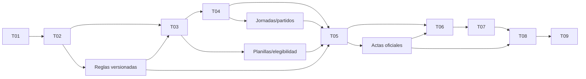

# 02. Hoja de ruta y dependencias

Las nueve tandas adaptan la especificación maestra a la decisión móvil del 27/10/2026. Las fechas de calendario se asignarán cuando exista equipo, capacidad y evidencia; esta hoja no promete duración. Todo es planificación.

| Hito | Tandas | Demostración de salida | Puerta de avance |
|---|---|---|---|
| H0 — base segura | 01 | Dos organizaciones aisladas, acceso por contraseña/invitación, superadmin activa y bloquea administradores | Seguridad y recuperación demostradas desde móvil. |
| H1 — torneo configurable | 02 | Organizador crea F5 y F11, equipos, administradores de equipo y comisiones | Reglas versionadas y permisos sin fuga. |
| H2 — buena fe y planilla | 03 | Equipo presenta jugadores con ficha, C.I. privada y origen interno/externo; F7 convoca 7+8 | Admin de equipo opera desde móvil sin habilitar indebidamente. |
| H3 — fixture | 04 | Generar jornadas, ordenar por horario/cancha y publicar/reprogramar sin duplicados | Calendario y cuadros correctos. |
| H4 — partido operable | 05 | Planillero captura goles/tarjetas, envía acta y autoridad aprueba; público distingue provisional/oficial | Sin eventos duplicados y corrección auditada. |
| H5 — deporte consistente | 06 | Tabla, goleadores, tarjetas, suspensión y multa se recomponen desde decisiones oficiales | Una rectificación cambia proyecciones una sola vez. |
| H6 — control y exportación | 07 | Bandeja de revisión móvil, comisión, multas deportivas y PDF privado | Permisos y versiones comprobados. |
| H7 — difusión | 08 | Flyer de jornada/resultado exportable y portal completo sin login | Datos, permisos de publicación y versiones correctos. |
| H8 — piloto preparado | 09 | Operación en teléfonos reales, carga, restauración, seguridad y soporte | Hallazgos críticos cerrados antes de uso real. |

## Dependencias

El diseño visual, los ensayos con usuarios y el presupuesto pueden avanzar junto a la tanda activa. Las dependencias del diagrama indican qué contrato debe estar estable antes de cerrar un flujo posterior.

## Piloto de descubrimiento antes y durante T01

Entrevistar a organizadores de varias modalidades, administradores de equipo y planilleros. Observar cómo crean equipos/comisiones, presentan listas de buena fe, ordenan fixtures y registran eventos. Probar prototipos de lista, planilla y partido a 320/390 px en un teléfono bajo luz exterior. Registrar tareas, tiempos, errores y reglas locales que varían.

## Seguimiento

Cada tanda tiene tickets `Txx-nn`, criterios de aceptación y una demostración reproducible en `tandas/`. Registrar implementación, pruebas, límites y decisión de avance en [avances](avances.md). Si una puerta falla, la tanda permanece abierta aunque otras tareas sigan progresando.
