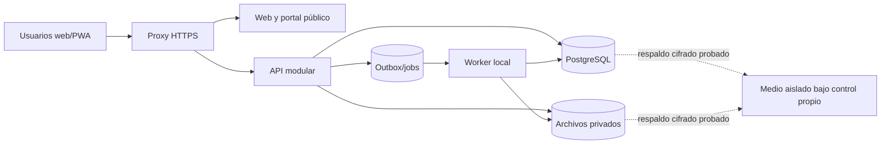

# 05. Arquitectura y modelo de datos inicial

## Criterio de arquitectura

Arquitectura adoptada en T01: monorepo con Vue 3/TypeScript/Vite **móvil primero**, API Fastify/Node/TypeScript y PostgreSQL nativo con SQL versionado. Instancia local independiente y sin contenedores, con worker de mantenimiento y almacenamiento privado. El proxy HTTPS, instalación PWA y dominios deportivos del diagrama se completarán en sus hitos. Sin microservicios prematuros, integraciones de terceros ni módulos de cobro. Ver [ejecución local](runbooks/desarrollo-local.md).

## Dominios y fuentes de verdad

| Dominio | Fuente de verdad | Derivados |
|---|---|---|
| Identidad/acceso | Usuario, hash de contraseña, sesión revocable, membresía, asignaciones y estado manual del superadmin | Menús y permisos efectivos. |
| Organización/torneo | Organización, torneo, edición, categoría, regla versionada, equipo y comisión | Vista pública y navegación. |
| Deportistas | Identidad privada, ficha por torneo, lista de buena fe, procedencia interna/externa, inscripciones con vigencia | Elegibilidad en fecha de partido. |
| Partido | Planilla congelada, log de eventos, acta/decisión oficial | Marcador, goleadores, tarjetas, tabla. |
| Disciplina | Caso, resolución, sanción y multa deportiva | Elegibilidad y estado visible al equipo autorizado. |
| Publicación | Estado público permitido, plantilla y snapshot de insumos | Flyer/PDF descargable, nunca mutado en silencio. |

## Jerarquía de pertenencia

`organization → tournament → edition → category → stage/round → match`. `team → team_entry` vincula participantes a categoría/edición; `team_entry → commission/staff/good_faith_list`; `player → registration → team_entry` conserva historia. Un usuario puede tener asignaciones a varios torneos o equipos con roles distintos. El superadmin existe fuera de un tenant; el acceso de soporte a privados requiere motivo y auditoría. Un origen externo es una declaración de procedencia, no un `team_entry` participante.

## Invariantes de base

1. Toda tabla privada de negocio lleva `organization_id`, y las referencias relevantes tienen clave compuesta o una validación equivalente que impida cruzar organizaciones.
2. El servidor resuelve y verifica organización activa desde membresía/permiso; `organization_id` enviado por cliente es solo selector, no autorización.
3. Inscripción, préstamo, regla, planilla y acta conservan vigencia/snapshot. Un cambio actual no reescribe historia.
4. `match_event_log` tiene `UNIQUE(match_id, client_event_id)` y secuencia de servidor por partido. Correcciones agregan registros con motivo, actor y referencia al evento original.
5. Resultado oficial se aprueba una vez por versión/decisión; la misma solicitud repetida devuelve el resultado ya aceptado. Proyecciones deportivas se pueden reconstruir.
6. El estado `active/suspended/blocked` de acceso se comprueba en cada request; cambiarlo revoca sesiones/asignaciones afectadas y conserva historia.
7. Cédula, ficha y dorsal nunca sustituyen el UUID del jugador; edad se calcula desde nacimiento a fecha de corte, no se guarda como cifra fija.
8. Lista de buena fe aprobada, comisión, decisiones y sanciones no se borran físicamente para “corregir”: crear nueva versión/decisión con rastro.
9. Documentos personales y de menores viven en almacenamiento privado con autorización por solicitud; no URLs públicas permanentes.
10. Una multa es resolución disciplinaria con importe si corresponde; no genera cuenta, saldo ni obligación de pago en el sistema.

## Estrategia de migraciones por tanda

| Tanda | Núcleo de tablas |
|---|---|
| 01 | users, sessions, organizations, memberships, invitations, access states/grants, audit logs, media mínimo. |
| 02 | tournaments, editions, categories, rule sets/versiones, teams, entries, comisión, staff, venues. |
| 03 | players, documentos, fichas, procedencias, listas de buena fe/versiones, inscripciones, transferencias, préstamos, `matches` mínimos en borrador y lineups. |
| 04 | stages, groups, rounds, programación completa de matches y conflictos de horario/cancha. |
| 05 | assignments, event log/corrections, clock, acts, signoffs, official results, outbox. |
| 06 | projections, adjustments, cases, decisions, suspensions, appeals, fines deportivas. |
| 07 | bandejas de revisión, versiones de exportación y registros de documentos privados. |
| 08 | templates, generated flyers/docs, news, sponsors/public media. |
| 09 | índices/particionado solo si medición lo exige; retención/monitorización. |

El catálogo original está en la especificación maestra §17, pero sus tablas financieras ya no pertenecen al alcance vigente. Su SQL de ejemplo es orientativo: no ejecutarlo directamente. Cada migración debe incluir índices, `CHECK`, claves, prueba de actualización desde estado anterior y procedimiento de recuperación.

## API y procesos

Usar comandos de dominio para `SetTournamentAdminAccess`, `ApproveGoodFaithList`, `ReviewExternalOrigin`, `PublishRound`, `SubmitLineup`, `RecordMatchEvent`, `ApproveAct` y `CorrectOfficialAct`. Exigir clave de idempotencia en publicaciones y eventos críticos. `version` o bloqueo transaccional protege ediciones simultáneas. La respuesta indica estado, versión y error legible. SSE/WebSocket difunde solo hechos persistidos; tras reconectar el cliente recupera desde secuencia de servidor.
