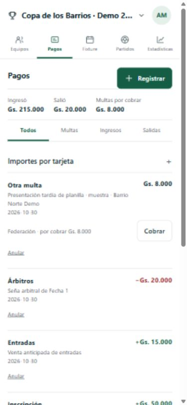

# Pagos internos y torneo de prueba — 30/10/2026

## Alcance entregado

- Torneo local sintético `Copa de los Barrios · Demo 2026` (`7418de31-f88f-4b7a-9062-bf9ab98236c6`), creado con `npm run demo:ready`. Cuatro equipos, 32 jugadores ficticios, listas de buena fe aprobadas, reglamento y fixture publicados. La primera Fecha tiene dos partidos previstos para el 01/11/2026 a las 18:00, sin resultado; el torneo está por iniciar.
- Al crear un torneo se fijan importes de multa por amarilla y roja. Configuración → Importes por tarjeta abre su edición en Pagos. Cada cambio crea una versión; los cargos anteriores conservan su importe.
- Desde Pagos o desde un equipo, el organizador registra una multa a favor de la federación, un ingreso efectivo o una salida. Conceptos de ingreso: entradas, inscripción, derecho de partido y otro. Conceptos de salida: árbitros y otro. La multa es ingreso por cobrar hasta que se registre su cobro total o parcial; el cobro aparece en Ingresos. La suma distingue **Ingresó**, **Salió** y **Multas por cobrar**, sin contar dos veces una multa.
- Los movimientos pueden anularse con motivo y dejan rastro. Una multa con cobros vigentes exige anular primero esos cobros. El formulario de registro y el motivo de anulación están cerrados hasta elegir la acción.

## Datos y migración

La migración aditiva `035_tournament_payments.sql` agrega tarifas versionadas por torneo y movimientos de dinero vinculados opcionalmente a un equipo. Organización y torneo forman parte de las claves de alcance. El libro es privado; no modifica el catálogo ni las resoluciones deportivas de T06. Antes de migrar se ensayó restauración de respaldo cifrado con 60 tablas y 534 archivos idénticos. Tras crear la muestra se repitió el respaldo/restauración: 62 tablas y 545 archivos idénticos. No se borraron datos ni se usaron contenedores.

## API, permisos y estados

Las rutas privadas permiten leer libro y tarifas, versionar tarifas, registrar multa/ingreso/salida y anular movimiento. La autorización toma la organización de la sesión y comprueba torneo, equipo y cargo vinculados. Prueba de acceso permitido para organizador y denegación para otra organización, administrador de equipo, superadmin y equipo de otro torneo. Se validan importes, categoría, equipo requerido para multa y cobro que no supere el saldo. Estado vacío: `Sin movimientos.`; los errores de API se muestran sin borrar el formulario.

## Verificación local

`npm run typecheck`, `npm run build` y `npm test` finalizaron bien; **79/79 pruebas**. En el navegador móvil local se comprobó el torneo en Equipos y Pagos a 390 px; Pagos muestra Gs. 215.000 ingresados por inscripciones/entradas, Gs. 20.000 salidos por seña arbitral y Gs. 8.000 de multa por cobrar a favor de la federación. Configuración → Importes por tarjeta abre amarilla Gs. 10.000 y roja Gs. 25.000. Se revisó la interfaz a 320, 390, 768 y 1280 px sin desborde horizontal; la aceptación con teclado virtual, red inestable y teléfonos físicos permanece pendiente.

