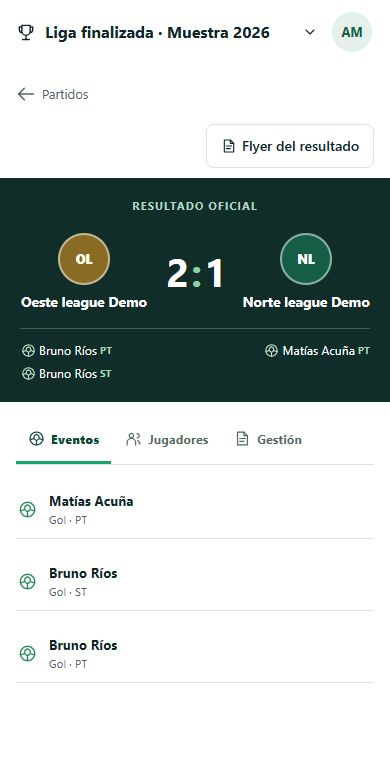
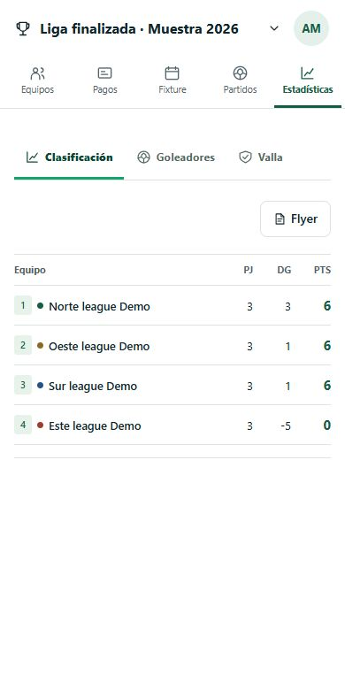
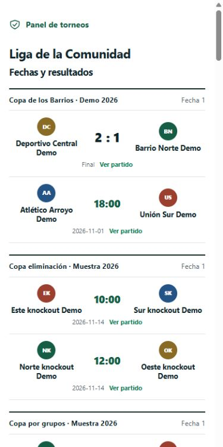
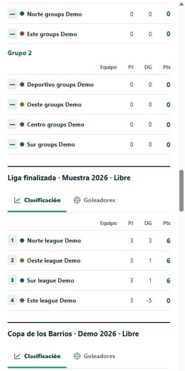
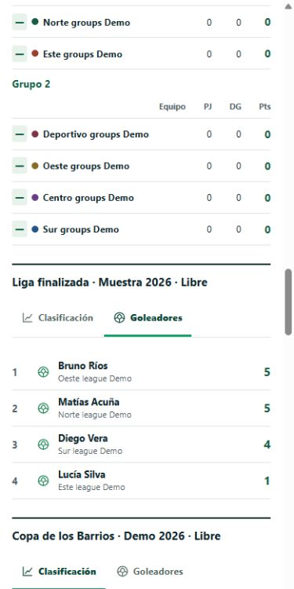
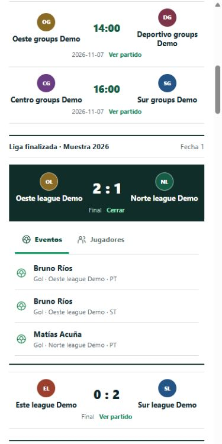
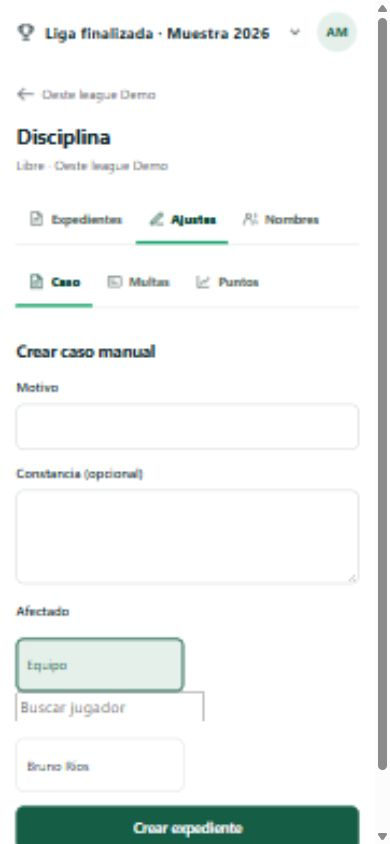
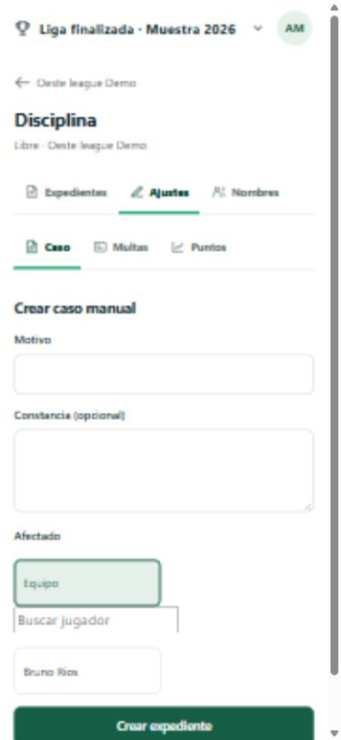

# Pestañas deportivas — 04/11/2026

## Incremento

- **Datos/migración:** sin migración. La respuesta pública existente de Fixture añade eventos del acta aprobada o presentada; los anulados se excluyen.
- **API:** se entregan tipo, equipo, período y nombre solo cuando la publicación individual del jugador está autorizada. Las tarjetas personalizadas toman nombre y color del reglamento versionado de ese partido. Un nombre privado aparece como «Jugador». No se entregan identificadores de inscripción, nota de incidencia ni motivo de corrección.
- **UI:** pestañas accesibles dentro de Estadísticas, Partido, Equipo, ficha de Jugador y Disciplina. El portal conserva Fechas y resultados, Cuadros, Clasificación y goleadores, Flyers y equipos en su orden; Clasificación y Goleadores son subpestañas de su sección, y cada partido público ofrece Eventos y Jugadores. El marcador y los escudos permanecen visibles. Cada símbolo deportivo tiene etiqueta accesible.
- **Permisos:** los datos privados de roster se cargan solo por la ruta de equipo con permiso de servidor; el portal usa exclusivamente el fixture publicado y la visibilidad individual de nombres en planilla y eventos. La prueba de integración verificó fixture propio visible y partido ajeno ausente.
- **Vacío/error:** pestañas sin goles, fechas, jugadores o flyers indican el vacío en una línea. La interfaz tolera respuestas de fixture antiguas sin `events` durante la actualización local.
- **Pruebas:** `npm test` 82/82 tras la rectificación del portal; `npm run typecheck` y `npm run build` correctos. Flecha derecha de teclado cambió Clasificación por Goleadores. CUA confirmó `scrollWidth === clientWidth` a 320, 390, 768 y 1280 CSS px en portal, Estadísticas, Partido, Equipo, Jugador y Disciplina.
- **Pendiente:** dispositivos físicos, teclado virtual, lector de pantalla completo, red inestable y aceptación estética con el propietario.

## Capturas locales a 390 px

